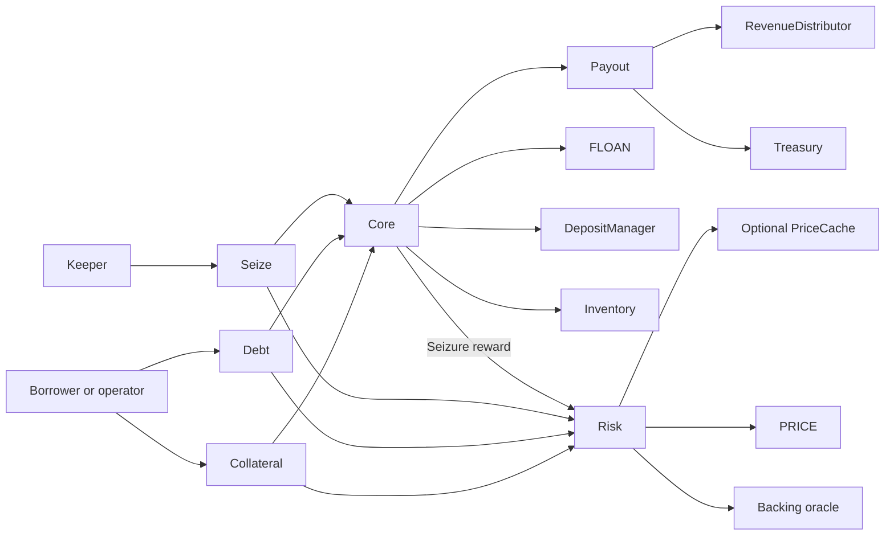

# Burner Loans

## Purpose

Burner Loans lends OHM against approved collateral for a fixed term. It charges an upfront collateral-denominated fee instead of interest. Loans draw supplied OHM first, then mint any shortfall within the global debt cap.

Borrowers repay OHM. Anyone can seize a position after maturity or when its health factor falls below `1e18`. Seizure defaults its principal, pays any permitted keeper reward and sends the remaining collateral to Treasury.

This guide describes the modular contracts in this branch, not a deployed configuration or activation approval. See the [access-control reference](burner_loans_access_control.md) for permissions and the [Inventory reference](burner_loans_inventory.md) for OHM accounting.

## Architecture

Public action contracts validate requests and call `BurnerLoansCore` for complete settlement. The component table identifies each contract in the modular implementation.



| Component | Responsibility |
| --- | --- |
| `BurnerLoansCore` | Permanent FLOAN facility and DepositManager operator; authorization grants, asset registry, transfers and accounting settlement |
| `BurnerLoansCollateral` | Deposit and withdrawal validation, quotes and execution |
| `BurnerLoansDebt` | Borrowing, repayment and extension validation, quotes and execution |
| `BurnerLoansSeize` | Permissionless batch liquidation and keeper validation |
| `BurnerLoansRisk` | Prices, health, fees, configuration validation and keeper-reward calculations |
| `BurnerLoansInventory` | OHM funding, provider claims, active principal and MINTR approval |
| `BurnerLoansPayout` | Received protocol fees, referral and keeper obligations, seized collateral, payout retries and recovery |
| `BurnerLoansConfig` | FLOAN market configuration, Core registry updates, Risk cache-age forwarding and Core surplus recovery |
| `BurnerLoansConfigTimelock` | Delayed delegated Config changes and Core surplus recovery |
| `BurnerLoansRiskConfigTimelock` | Delayed referral percentage, referrer membership and cache-age changes on its immutable Risk target |
| `BurnerLoansPayoutConfigTimelock` | Delayed Payout flags and recovery, independently of the market-configuration queue |
| `BurnerLoansInventoryConfigTimelock` | Delayed Inventory surplus burning or rescue through Inventory's independent controller |
| `BurnerLoansLens` | Position views and bounded seizure scans; no independent policy lifecycle |
| `BurnerLoansSeizerTask` | One managed asset visit per Heart execution |
| `BurnerLoansYieldClaimerTask` | Direct yield claims and bounded iteration over Core's asset registry |
| `BurnerLoansComposites` | Combined public actions in one transaction |

FLOAN stores positions, market configuration and principal indexes. DepositManager stores collateral liabilities, vault shares and receipt accounting. Core stores the selected market ID and withdrawal mode for each registered asset. Actions and Lens use that record rather than discovering a market by token-pair order.

Core grants no economic guarantee merely because a caller has a settlement role. It authenticates the operation-specific role and settles the supplied request. Governance must grant those roles only to reviewed action contracts. Core does not require a role holder to report a Kernel or have active-policy membership.

## Position lifecycle

A borrower uses one canonical position per registered asset market. Later debt episodes reuse its position ID.

The first borrow fixes an absolute maturity. Additional borrowing adds principal without changing that maturity. An extension applies the current term and maturity horizon to the entire outstanding principal. Configuration changes do not rewrite a stored maturity.

For example, a later term reduction does not shorten an existing loan. A future extension uses the reduced term and must fit within the current horizon.

| Action | Effect | Main condition |
| --- | --- | --- |
| Deposit | Adds the underlying-denominated credit reported by DepositManager | First deposits and top-ups are allowed with originations enabled or disabled, subject to the other deposit checks |
| Borrow | Adds principal and, for a new debt episode, sets maturity | Originations enabled, healthy position, valid maturity and available capacity |
| Repay | Reduces principal and returns OHM to Inventory | Payer supplies its own OHM; repayment is not in the latest borrow block |
| Withdraw | Removes collateral credit and returns underlying or shares | Any remaining debt stays healthy |
| Extend | Advances the shared maturity | Originations enabled, valid term/horizon, health and accepted fee |
| Seize | Defaults all principal and removes collateral | Nonzero debt is matured or health is below `1e18` |
| Claim yield | Transfers custody surplus to the current yield recipient | Valid custody path and operational claim dependencies |

Full repayment clears the debt episode. Seizure also removes collateral and updates cumulative default accounting. Neither operation requires a new position ID for a later episode.

## Operating states

Kernel activity and local enablement are independent. Ordinary action execution requires the action and its required downstream services to be operational. A local pause is separate from an asset's `originationsEnabled` flag.

Disabling asset originations blocks borrowing and extensions. First deposits, top-ups, repayments, withdrawals, seizures and yield claims remain available, subject to their other checks.

Disabling an action or a settlement dependency can still block servicing. To stop new borrowing while preserving exits, close asset originations rather than pausing every component.

Pausing Payout stops new credits. Retries and authorized Payout recovery require Kernel activity, including after Core selects a replacement. Local pause does not block recovery. They require Core settlement to be idle. Core surplus recovery requires Core's Kernel activity but permits local disablement. See the [authority matrix](burner_loans_access_control.md) for each path.

## Health, pricing and fees

Risk calculates health using the current FLOAN market configuration. Prices and USD values use `PRICE.decimals()`. The backing oracle returns 18-decimal USD per OHM; Risk converts it to the PRICE scale, rounding up.

[BackingOracle](backing_oracle.md) stores that value independently of Risk. Its separate, replaceable `BackingOracleConfigTimelock` applies delayed updates with a fixed one-day notice. `backing_admin` proposes updates and can recover the oracle or its queue within grace; `burner_loans_admin` does not confer those permissions. Pausing or deactivating the oracle blocks updates but leaves the last value readable by Risk.

```text
marketRequirementUsd = ceil(debtValueUsd * 10_000 / maxLtvBps)
backingRequirementUsd = ceil(debtBackingValueUsd * backingMultiplierBps / 10_000)
requiredCollateralUsd = max(marketRequirementUsd, backingRequirementUsd)
healthFactor = floor(collateralValueUsd * 1e18 / requiredCollateralUsd)
```

Debt value and collateral requirements round up. Collateral value and health round down. Token quantities use their own token decimals. Vault yield does not increase position collateral credit or borrower health.

`maxLtvBps` supplies the market-value buffer. `backingMultiplierBps` supplies a separate backing-value requirement. The stricter branch changes at this OHM market-price-to-backing-value ratio:

```text
crossover = (maxLtvBps / 10_000) * (backingMultiplierBps / 10_000)
```

| Position state | Health rule |
| --- | --- |
| No debt | Health is `type(uint256).max`; the position is not seizable |
| Health at least `1e18` | Health permits new risk, subject to the remaining checks |
| Health below `1e18` | New risk is rejected; the position is health-seizable |
| Maturity reached with debt | The position is seizable regardless of its health |

### Price selection

Risk owns `backingOracle`, `priceCache` and `priceCacheMaxAge`. Zero cache selects direct PRICE reads. A configured cache is used only while active and enabled; otherwise Risk uses PRICE. Cache compatibility and lifecycle errors remain distinct, including the shared Kernel-mismatch error.

Views use a fresh cached snapshot or read PRICE without writing the cache. Price-dependent actions refresh an operational cache when necessary. An error from an operational cache propagates. Debt-free health does not need a price read.

A full repayment has a debt-free result, but it still applies custody, amount and same-block validation. Repaid positions with remaining debt use current pricing for their resulting health.

Cache age is a `uint48` number of seconds with no additional protocol maximum. Risk has its own `configOperator`, normally RiskConfigTimelock. This queue calls its immutable Risk target directly. Config retains a forwarding method that requires selecting Config as Risk's operator instead. A Core Config rotation does not update Risk's authority automatically.

### Fees

Borrow and extension fees are collected separately in the collateral token. They do not reduce credited collateral or accrue as interest. Fees use pre-action market utilization; the global debt cap is not a fee input.

```text
utilization = ceil(marketPrincipalDue * 1e18 / marketPrincipalCap)
base = baseFeeBps * 1e14
kink = kinkBps * 1e14
preSlope = preKinkSlopeBps * 1e14
postSlope = postKinkSlopeBps * 1e14

at or below a nonzero kink:
feeRate = base + floor(utilization * preSlope / kink)

after the kink:
feeRate = base + preSlope
        + floor((utilization - kink) * postSlope / (1e18 - kink))
```

The rate and utilization are WAD-scaled. A zero-kink configuration requires zero slopes and gives a constant base rate. Final token-denominated fees round up. Borrowing charges the incremental required collateral; extension charges the required collateral for the extended debt and requested terms.

`maxFee` bounds the total accepted fee (`protocolFee + referralFee`). Neither borrow nor extend accepts a maturity-slippage bound. Clients must quote the current terms and show the resulting maturity before submission.

### Referral fees

Borrow, extend and their previews accept a referrer address for that operation. Zero selects no referral fee. A nonzero referrer must be whitelisted by Risk, including when the fee or referral percentage is zero. Each operation can name a different referrer; positions do not store attribution. A positive referral allocation cannot name the selected Payout as its destination. Debt and Seize previews call Payout.validatePayoutRecipient for positive referral or keeper allocations; Payout uses the same validator for settlement and retries. Payout also rejects zero or itself for positive keeper and protocol allocations and for direct payout retries. A zero referral allocation does not require destination admission.

Risk splits the existing upfront fee using one shared percentage: `referralFee = floor(totalFee * referralFeeBps / 10_000)` and `protocolFee = totalFee - referralFee`. The percentage ranges from zero to 100%. It does not increase the total fee. Borrow, extend and their previews return only the combined `fee` alongside position data; `maxFee` applies to that sum. Debt keeps the components internal and passes them separately to Core for Payout settlement.

Debt obtains both components from Risk and passes them separately to Core. Core collects their exact sum from the caller into Payout, then credits the two allocations. Payout routes the protocol component and pays the named referrer. A failed optional referral payment remains fully reserved for that original address. Debt emits `Borrowed` or `Extended` with the borrower, referrer, `protocolFee` and `referralFee` for that operation, including when delivery is deferred. The two fee fields sum to the total charged. Payout emits `PayoutTransferred`/`PayoutDeferred`, whose amounts may include earlier pending fees; retries do not emit loan events.

ADMIN or Risk's selected operator can change the percentage and whitelist. RiskConfigTimelock permits ADMIN or `burner_loans_admin` to queue these changes with notice. Percentage, cache age and each referrer's membership have independent conflict keys and state commitments, so they can be pending and executed in any order. Changes affect future operations; earned rewards retain their original token, recipient and amount.

## Collateral custody

Core is the DepositManager operator and spender for settlement. User authorization remains on Core when an action contract is replaced. FLOAN records the underlying-denominated credit returned by DepositManager, including vault rounding.

The market's `withdrawAsShares` setting selects underlying or share output for withdrawals, seizures and yield claims. DepositManager validates that the selected mode is supported. Configure routes for the actual output token, including share tokens, rather than assuming that every payout uses the underlying asset.

Governance must review token and vault behavior before asset admission. Fee-on-transfer and rebasing collateral are unsupported. Core, Inventory and DepositManager enforce exact receipt at their respective mandatory incoming boundaries. Outgoing transfers still depend on the admitted token moving the requested amount when it reports success.

Token-moving entry points use reentrancy guards. Composites execute complete settlements in sequence; a later failure rolls back the entire transaction.

See [Deposit Manager](deposit_manager.md) for custody modes and [Inventory](burner_loans_inventory.md) for OHM accounting and MINTR failure handling.

## Yield routing

Payout chooses one recipient for protocol fee allocations and one for custody yield. A false send flag selects Treasury. A true flag selects the configured RevenueDistributor. These flags belong to Payout, not Config or Core. Referral allocations always belong to the named referrer.

Core collects fees directly from the payer into its selected Payout and directs DepositManager to redeem seizure proceeds into that Payout. Payout reserves incoming obligations before best-effort delivery. A failed optional transfer remains pending there. Yield is different: DepositManager sends the actual output token directly to Payout's selected yield recipient. A failed yield transfer leaves the yield claimable in DepositManager.

Borrow, extend and yield claims do not depend on a RevenueDistributor token route being configured. Configure the expected underlying and share-token routes before enabling a source flag.

### Seizure proceeds and deferred payouts

Seizure pays a permitted keeper reward and sends the entire remainder to Treasury. The remainder never follows RevenueDistributor flags. A caller with `heart` or `burner_loans_seizer` receives no keeper reward.

| Pending amount | Destination when retried |
| --- | --- |
| Protocol share of borrow or extension fee | Current Payout fee recipient |
| Referral fee | Original referrer, even after whitelist removal or percentage changes |
| Keeper reward | Original keeper |
| Seizure remainder | Current TRSRY module |

Each Payout instance owns its received tokens and pending ledger. Anyone can use `getPendingPayoutTokens()`, `getPendingPayoutRecipients(token)` and `transferPendingPayout(token, recipient)` on that instance. Referral fees also have `pendingReferralFee(token, recipient)` and `getPendingReferralRecipients(token)` getters. `pendingKeeperReward(token, keeper)` reports only the original keeper's reward; `pendingRecipientAmount(token, recipient)` combines every eligible bucket for one recipient. Retries require the Payout's Kernel activity and remain available after local pause or replacement, outside Core settlement. Failed transfers retain their reserves. `pendingAmounts(token)` returns pending protocol fees, pending referral fees across all recipients, seized collateral, pending keeper rewards across all recipients and total obligations, in that order. The four component reserves sum to the total. All four categories reject Payout itself as the destination of a positive allocation before recording credit. Actual token delivery failures to valid recipients still defer.

### Rescue

Core's `rescue` recovers tokens held directly by Core. It does not consume Payout obligations. Config and ConfigTimelock provide a delegated path for Core surplus recovery.

Payout's `rescue` transfers only unreserved surplus. Its `rescuePendingPayout` redirects an exact positive amount from a recipient's live entitlement. The latter debits keeper rewards, protocol fees, seized collateral, then referral fees when those buckets resolve to the same recipient. A failed mandatory rescue transfer rolls back the accounting changes.

Authorized pending-payout rescue includes referral fees. Its preview and `pendingRecipientAmount` use the same complete entitlement; referral recovery debits the original recipient, aggregate referral reserve and recipient index. Referral fees remain protected from surplus rescue.

Payout recovery accepts ADMIN or its local nonzero config operator. PayoutConfigTimelock delays delegated flag and recovery changes; direct ADMIN repair remains available.

Payout validates token code and destination restrictions, including zero, itself, Core, the token, its config operator and Kernel. Recovery does not bypass those restrictions or the live entitlement checks. Its preview functions are permissionless and do not reserve funds for later execution.

## Seizure automation

SeizerTask binds Lens and Seize directly. They must report the same Core, and Seize must belong to the task's Kernel. Adding an asset requires a configured market. The task visits one managed asset per `execute()` call, then rotates to the next asset even if that visit fails.

Within an asset, the scan has independent check and seizure limits. The task stores a borrower cursor per asset. Before a nonzero scan, it checks the current borrower count and resets an out-of-range cursor within the same visit. A successful seizure rewinds for borrower-list compaction. Scan or seizure failures retain borrower progress; a failed complete self-call still rotates the asset in the outer call.

An inactive task rejects execution. An active but disabled task returns without work. Inner work has a gas limit and an outer reserve for failure reporting and rotation. Operators can change either cursor through the task's explicit setters.

YieldClaimerTask instead iterates Core's append-only asset registry. It advances its cursor before each isolated claim, retains cleanup gas and stops before another attempt when the budget is too low. Its inactive execution reverts; local disablement returns without work. It skips the body while Core is unavailable. A registry-read failure can roll back the whole self-call, including that beat's cursor changes.

Configure Heart to warm prices before seizure, then claim yield before RevenueDistributorTask. PriceCacherTask has an independent pair set and no configurable execution gas limit. Keep its workload bounded. See [Price Cacher Task](price_cacher_task_access_control.md) and [Revenue Distributor](revenue_distributor.md).

## Configuration model

ADMIN selects Core's Risk, Inventory, Payout and config operator. Risk, Inventory, Payout and Config each have separate delegated controllers. Rotating Core's controller does not rotate those other controllers.

Config manages complete risk and fee structs, asset caps, withdrawal mode and origination state. New assets are ADMIN-only and start with originations enabled. The facility-wide debt cap is an ADMIN-only Inventory setter. Config has no `setGlobalDebtCap`, routing-flag setter or `setFacility` wiring step.

ConfigTimelock targets one Config. RiskConfigTimelock targets one Risk. PayoutConfigTimelock targets one Payout. InventoryConfigTimelock targets one Inventory and exposes typed burn/rescue proposals. Queued actions commit their destination, configuration domains and pre-state. Drift can invalidate execution. Valid execution is permissionless within the delay/expiry window, subject to the concrete queue's checks. Batches are atomic. RiskConfigTimelock remains usable while Config and Core are paused or inactive; it requires the queue and Risk operational.

Distributor pointer replacement is ADMIN-only on Payout and is not a PayoutConfigTimelock action, including in a batch. Disable both routing flags before clearing the pointer. Flags have separate keys, so a delayed batch can turn both off before a later direct ADMIN clear.

### Replacing Burner Loans Config

Config is constructor-bound to Core. `Core.setConfigOperator(replacement)` updates the selected authority and hands off each registered FLOAN market manager atomically. It uses Core's stored market IDs; an unrelated matching token-pair market is not included.

Core rejects zero and unchanged authorities. It does not validate the upstream operator's interface, Kernel or lifecycle. Governance must choose the correct constructor-bound Config and initialize its own dependencies.

A replacement procedure is:

1. Deploy the replacement Config bound to the existing Core and activate it.
2. Deploy and activate any replacement ConfigTimelock; leave local controller selection until Config is enabled.
3. Retain or select the independent Risk controller. RiskConfigTimelock is bound to Risk and does not change when Config is replaced. Selecting Config instead enables its cache-age forwarding only.
4. Call `Core.setConfigOperator(replacement)` in the same governed batch where appropriate.
5. Enable the replacement Config, select its local config operator, then enable its queue after their binding checks pass.
6. Verify registered market managers and independent controller assignments. Inspect unregistered markets before retiring the outgoing Config and queue.

Inventory's recovery operator and Payout's routing controller remain separate. Simulate the full manager handoff against live state: the registry has no protocol asset-count bound, and the handoff is not paginated. A failed market handoff reverts all earlier handoffs and the Core pointer change.

## Deployment and activation

This is a dependency order, not a reviewed production deployment script. Confirm addresses, roles, module permissions and transaction ordering in the deployment proposal.

1. Install the required ROLES, FLOAN, MINTR, PRICE and TRSRY modules. Deploy and activate DepositManager and its receipt infrastructure.
2. Deploy Core with its permanent OHM and DepositManager identities, then activate it while disabled.
3. Deploy Core-bound Inventory, Payout, Config and Risk, plus Lens and the required actions and tasks.
4. Activate the policies and grant their operation-specific roles. Prepare the independent Risk, Inventory and Payout controllers.
5. Verify DepositManager is active and enabled. Enable Inventory, Payout and Risk, then select those services on Core using ADMIN.
6. Select Config on Core. Enable Core, then Config and the public actions after their dependency checks pass. After enabling Config, select its local config operator.
7. Grant Core `deposit_operator` and register its DepositManager operator name. Configure custody and enabled period-1 routes for Core, plus required prices. Add each asset through Config and set Inventory capacity.
8. Configure RevenueDistributor routes and Payout flags before relying on routed fee or yield receipts.
9. Enable each required queue and task after its own target/binding checks pass, then configure Heart ordering.

Risk can bind a precomputed Core address at construction; Core checks the returned identity when selecting it. Lens has no Kernel activation or enable step. Payout supports the shared re-enable/grace API: ADMIN or burner_loans_admin can re-enable it within the inclusive grace window (seven days by default), while only ADMIN can change the nonzero grace period on an active, enabled Payout. Enable and re-enable require Payout's own Kernel activity and idle local/Core settlement guards, without requiring Core activity, enablement or current Payout selection. Pausing or re-enabling preserves pending obligations and custody; recovery remains available while locally paused or replaced.

For delayed Risk settings, deploy RiskConfigTimelock with the deployed Risk address. Activate Risk and select this queue as its operator while Risk and the queue are disabled. Enable Risk, then activate and enable the queue. The queue needs no ADMIN role or FLOAN write permission. Referral percentage starts at zero and the whitelist starts empty; configure them through queued actions or direct ADMIN governance.

## Policy replacement and wind-down

Replacing an action preserves FLOAN positions, Core authorizations and DepositManager's operator namespace. Grant the replacement its settlement role, enable it after dependency checks, then revoke the old role. Update immutable Composites and task bindings when their actions change.

Risk replacement selects new pricing and economic code for existing positions. It requires a compatible, active, enabled, same-Kernel, same-Core Risk with the same OHM token. It does not copy controller settings from the old Risk.

Payout replacement redirects future settlements. It neither migrates nor erases old balances and obligations. Keep recovery access to every obligations-bearing instance. Keep those policies active during Kernel migration so their Kernel bindings are updated. A deactivated Payout does not receive automatic module-dependency refreshes.

Inventory pointer replacement checks canonical principal and matching aggregate ledgers. It does not migrate individual provider claims or OHM balances. See the [replacement procedure and limits](burner_loans_inventory.md#replacement).

Core itself and its DepositManager operator namespace have no built-in live-state migration. A new Core needs a separate stack. Keep repayment, withdrawal and seizure available while winding down the old stack.

### Retirement checklist

Before retiring an old Core stack:

- Disable originations in every old market and finish repayment, collateral withdrawal or seizure.
- Reconcile FLOAN collateral, principal, interest and active-borrower indexes against the old facility.
- Clear DepositManager liabilities and borrowed balances, and resolve remaining yield and dust.
- Reconcile Inventory provider claims, active principal, idle funding, cap and MINTR approval.
- Settle or govern recovery of liabilities on every old Payout, including deselected instances.
- Disable automation only after its servicing work is complete.
- Revoke settlement and custody authority after user exits and recovery are complete.

## Preview semantics

Previews belong to their actions: Collateral, Debt, Seize and YieldClaimerTask. Core and Payout expose previews for their own rescue operations. Lens supplies position views and scans.

Previews are permissionless and apply the relevant input, lifecycle and economic checks. Invalid requests revert. Collateral, Debt and Seize previews have no `executable` field. `ClaimYieldPreview` retains that boolean in its ABI and returns it as true on a successful quote; it does not report invalid requests as false. Execution still checks borrower/operator authority and required token transfers. Seizure quotes use the supplied keeper context where that changes the reward.

A preview does not reserve prices, fees, capacity, custody output or maturity. Another transaction or a permissionless cache write can change the result before execution. Use the same block for related off-chain reads and retain execution fee limits.

## Launch parameters

The [launch-parameter proposal](burner_loans_launch_parameters.md) contains the proposed USDS and USDe settings, rationale and stress examples. Those values require governance approval and are not a statement of deployed configuration.

## Gas verification

Commit `58f911187c` records a gas-snapshot baseline from before referral fees and shared destination validation. The figures below describe that historical bytecode. The focused deploy-profile run passed 381 tests across 21 suites, including 16 pinned-mainnet fork cases. Seventeen snapshot files changed; four groups reproduced their committed values. The count includes ordinary regression tests in the selected files, not only gas measurements.

The run used solc 0.8.36, optimizer 400, Prague, transaction isolation and snapshot emission. Use `FOUNDRY_PROFILE=deploy` for a gas run and `pnpm run format:snapshots` before committing the output. The tests and snapshot labels define each measurement's scope. This result is not a full repository campaign or deployment approval.

The fork tests pin mainnet block `25_894_485`. They verify the deployed PRICEv1.2 version, feeds and exact prices, then override VERSION metadata to satisfy Risk's major-version admission. Pricing calls, storage and tokens remain fork code. This fixture does not prove that Risk activates unchanged against the deployed module.

First borrowing measures 1,513,683 gas with direct fork PRICE and 618,763 with fresh PriceCache. A healthy 500-position scan measures 21,966,410 gas in the scan fixture. The recovery test reduces the page to 100 positions to make progress within a ten-million-gas task budget. Estimate limits against the actual deployed state.
