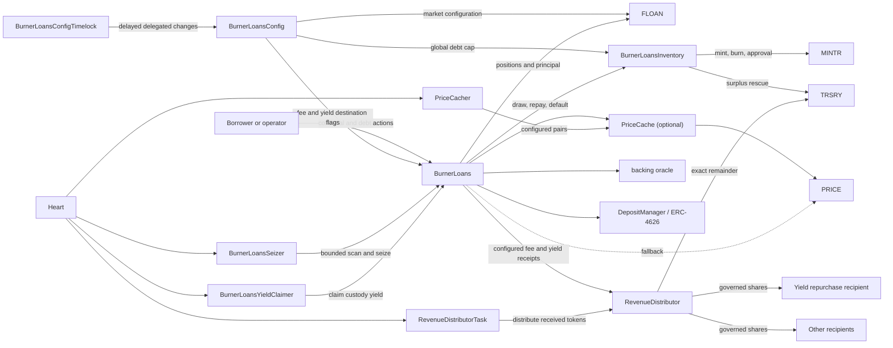
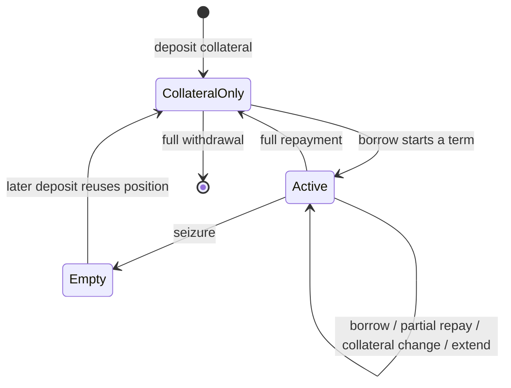
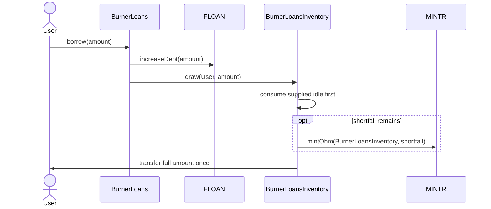
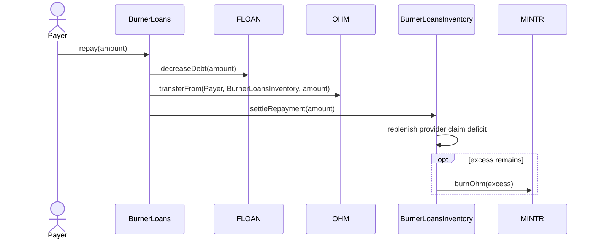
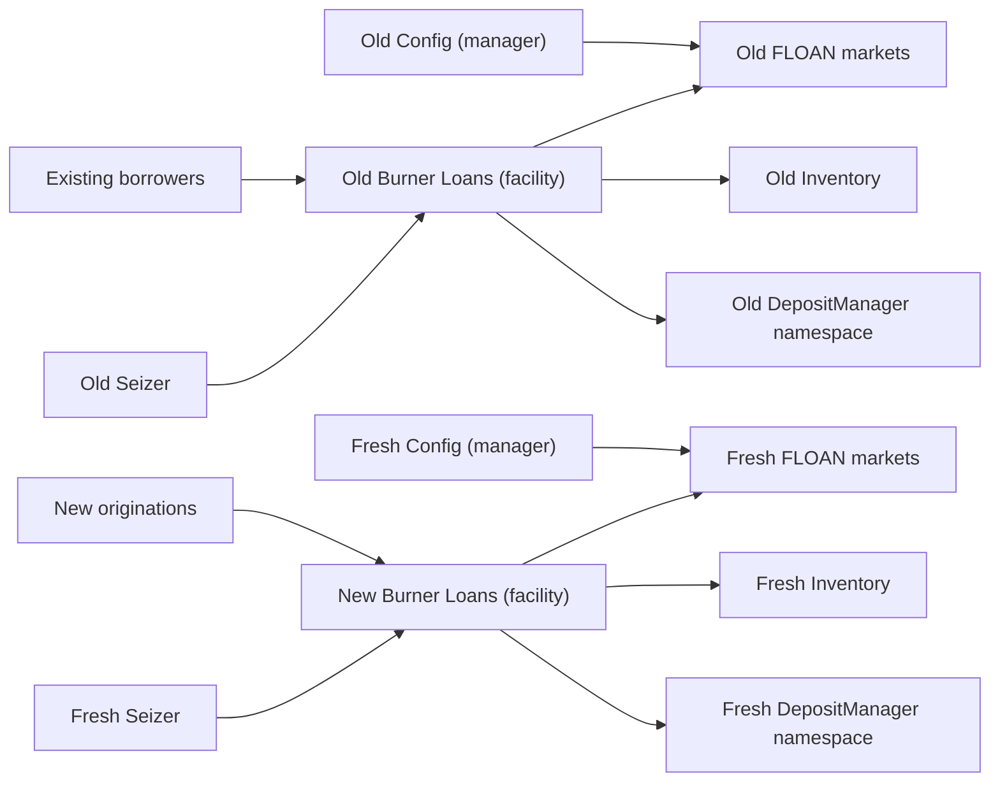

# Burner Loans

## Purpose

`BurnerLoans` is a fixed-term, 0% interest OHM shorting facility. A borrower deposits an approved
collateral asset, draws OHM, and later repays OHM. The draw may use protocol-supplied OHM, newly
minted OHM, or both. If a position matures or becomes unhealthy, anyone can seize it. Seizure
records its principal as defaulted, pays any permitted keeper reward, and sends the remaining
collateral to `TRSRY`.

The generic [FLOAN module](./floan.md) owns markets, positions, and principal indexes. Burner Loans
adds collateral custody, pricing, fees, health rules, funding inventory, and automated seizure.

## Architecture



| Component                                                                              | Responsibility                                                                |
| -------------------------------------------------------------------------------------- | ----------------------------------------------------------------------------- |
| `BurnerLoans`                                                                          | User lifecycle, health, custody, and pending fee or seizure payouts           |
| [`BurnerLoansInventory`](./burner_loans_inventory.md)                                  | OHM custody, provider claim, global cap, principal total, and MINTR authority |
| `BurnerLoansConfig`                                                                    | Authorized market, debt-cap, and destination flag forwarding                  |
| [`BurnerLoansConfigTimelock`](./burner_loans_access_control.md#config-timelock-matrix) | Timelocked delegate for bounded Config setters                                |
| `BurnerLoansSeizer`                                                                    | Gas-bounded, fail-open periodic seizure                                       |
| `BurnerLoansYieldClaimer` | Periodic custody-yield claims to the selected destination |
| [`RevenueDistributor`](./revenue_distributor.md) | Allocation and retry of its own fee and yield receipts |
| `RevenueDistributorTask` | Gas-bounded periodic distribution with a resumable cursor |
| `PriceCacher`                                                                          | Generic fail-soft warming of independently configured PriceCache pairs        |
| `PriceCache`                                                                           | Reusable timestamped snapshots sourced from the installed PRICE module        |
| `FLOAN`                                                                                | Generic fixed-term market, position, active-index, and aggregate state        |
| `DepositManager`                                                                       | Collateral custody and optional ERC-4626 routing                              |

Burner Loans Config requires exactly one FLOAN market for its facility, collateral token, and OHM
pair when reading or updating configuration. FLOAN itself permits another contract to create an
additional matching market. Lifecycle, quote, view, and seizure paths deliberately continue using
the earliest matching market so that such an external market creation cannot block servicing of
existing Burner Loans positions. Config lookups fail closed when the pair is missing or ambiguous.

Burner Loans is deployed before Burner Loans Inventory. `BurnerLoansInventory` permanently binds
that Burner Loans address as its facility, while Burner Loans stores a replaceable
`BurnerLoansInventory` pointer. Burner Loans Config is deployed without a facility link. After all
three policies are active, admin links Config to Burner Loans, Burner Loans Inventory to Config,
and Burner Loans to both policies while each destination contract is disabled. Enablement
revalidates the complete relationship before Burner Loans becomes operational.

## Position Lifecycle

Burner Loans uses the first FLOAN position for a borrower and market. FLOAN remains generic and can
store multiple positions. A completed Burner Loans debt episode reuses its position ID.

> **Important: one position has one maturity for all of its debt.** The first borrow in a debt
> episode fixes an absolute maturity using the term configured at that time. A later borrow adds to
> the same aggregate principal without changing that maturity, even if governance has since reduced
> the term length or maturity horizon. A later extension is different: it applies the term length
> and maturity horizon configured when the extension is requested to the position's entire
> outstanding principal. Neither a future borrow nor a future extension is guaranteed; current
> enablement, capacity, health, price, fee, and other validation still apply.

**Integration warning:** a preview does not lock the term configuration. `borrow` and `extend`
protect the accepted fee with `maxFee`, but they do not accept a maturity-slippage bound. Clients
should refresh the preview immediately before submission and display the resulting maturity
prominently for confirmation.

For example, suppose a position has 1,000 OHM of principal with a maturity established under a
30-day term and a 90-day horizon. If governance later changes the configuration to a 15-day term
and 30-day horizon, borrowing another 1 OHM does not shorten or otherwise reset the existing
maturity. The complete 1,001 OHM remains due at that same timestamp. If the borrower later extends,
the then-current 15-day term advances the shared maturity for all 1,001 OHM, and the resulting
maturity must fit within the then-current 30-day horizon.

Configuration changes therefore do not rewrite an active position's stored maturity. They do
govern new debt episodes and future extensions. A borrower is protected from a retroactive
shortening of an agreed maturity, but is not promised that current configuration or origination
availability will remain available for a later borrow or extension.



| Action              | Effect                                                        | Main condition                                                     |
| ------------------- | ------------------------------------------------------------- | ------------------------------------------------------------------ |
| Deposit collateral  | Adds DepositManager credit to the position                    | Burner Loans and asset originations are enabled                    |
| Borrow              | Adds principal; a new debt episode also fixes its maturity    | Position is healthy, within both caps, and not matured             |
| Repay               | Reduces principal and settles OHM into Burner Loans Inventory | Not in the borrow block; live PRICE unless repayment clears debt   |
| Withdraw collateral | Removes credit and returns custody assets                     | Remaining debt stays healthy                                       |
| Extend              | Advances the shared maturity of all debt by current terms     | Position stays healthy and maturity remains within current horizon |
| Seize               | Defaults all principal and removes all collateral             | Position is matured or below the health boundary                   |
| Claim yield         | Sends custody surplus to Treasury or Revenue Distributor     | Custody and the withdrawal mode remain valid                       |

Full repayment and seizure clear the episode's financial fields and active indexes. The position
ID remains reusable. `PositionClosed` and `PositionDefaulted` events contain the pre-clear snapshot;
market cumulative-default accounting preserves defaulted principal.

## Operating States

Asset `originationsEnabled` pauses new risk while allowing exits. The Burner Loans global
`enabled` flag pauses borrower actions, seizure, yield claims, and ordinary payout retries.
Authorized rescue remains available while locally disabled, provided Burner Loans is Kernel-active.

| Burner Loans action | Asset originations enabled | Asset originations disabled | Burner Loans disabled |
| ------------------- | -------------------------- | --------------------------- | --------------------- |
| Deposit collateral  | Allowed                    | Blocked                     | Blocked               |
| Borrow              | Allowed                    | Blocked                     | Blocked               |
| Extend              | Allowed                    | Blocked                     | Blocked               |
| Repay               | Allowed                    | Allowed                     | Blocked               |
| Withdraw collateral | Allowed                    | Allowed                     | Blocked               |
| Seize               | Allowed                    | Allowed                     | Blocked               |
| Claim yield         | Allowed                    | Allowed                     | Blocked               |
| Retry pending payout | Allowed                   | Allowed                     | Blocked               |
| Authorized rescue   | Allowed                    | Allowed                     | Allowed               |

Burner Loans Inventory has only its global enabled state; Burner Loans owns origination control at
the asset level. See
[Burner Loans Inventory operating states](./burner_loans_inventory.md#operating-states) for its
complete action table and manual MINTR synchronization behavior.

## Health, Pricing, And Fees

Health is WAD-scaled; `1e18` is the seizure boundary.

All USD values in the calculation use `PRICE.decimals()`. The backing oracle's 18-decimal value is
rounded up into that scale before `backingRequirementUsd` is calculated, so debt, collateral, and
both requirements share one scale.

```text
marketRequirementUsd = ceil(debtValueUsd * 10_000 / maxLtvBps)
backingRequirementUsd = ceil(debtBackingValueUsd * backingMultiplierBps / 10_000)
requiredCollateralUsd = max(marketRequirementUsd, backingRequirementUsd)
healthFactor = floor(collateralValueUsd * 1e18 / requiredCollateralUsd)
```

`debtBackingValueUsd` is the backing value of the outstanding OHM debt.

Collateral uses its gross current oracle value; no separate haircut is applied. `maxLtvBps`
converts debt market value into the market collateral requirement, so one parameter supplies the
market-value buffer.

`backingMultiplierBps` protects the liquid backing per backed OHM rate when OHM trades below its
backing value. Protecting that rate means the backing branch requires each borrowed OHM to have
collateral whose oracle value is at least its liquid backing multiplied by the configured factor.
At 100%, the position could be originated with collateral equal to liquid backing. A value above
100% requires additional collateral above that backing value.

The protocol uses the larger of the market and backing requirements, so a position cannot borrow
below either its maximum-LTV requirement or its backing requirement. The stricter branch changes at
this OHM market-price-to-backing-value ratio:

```text
crossover ratio = maxLtvBps / 10_000 * backingMultiplierBps / 10_000
```

Above the crossover, maximum LTV is stricter. Below it, the backing multiplier is stricter. Keeper
rewards are calculated separately and cannot consume collateral required by the backing branch.

| State                      | Borrow or withdraw                | Seizure                       |
| -------------------------- | --------------------------------- | ----------------------------- |
| No debt                    | Debt-free health is max `uint256` | Not seizable                  |
| `healthFactor > 1e18`      | Allowed if other checks pass      | Not health-seizable           |
| `healthFactor == 1e18`     | Exact boundary is allowed         | Not health-seizable           |
| `healthFactor < 1e18`      | New risk is blocked               | Seizable with current prices  |
| Maturity reached with debt | New risk is blocked               | Seizable without a price read |

PRICE values use `PRICE.decimals()`. OHM and collateral amounts use their token scales. The
backing oracle returns 18-decimal USD per OHM. Rounding is conservative for the protocol: debt USD,
backing conversion, collateral requirements, required collateral-token amounts, utilization, and
final transferred fees round up. Gross collateral values, health factors, and fee-curve slope
contributions round down.

Every borrower lifecycle action and position-action preview reports the resulting health factor.
`depositCollateral` and `previewDepositCollateral` return credited collateral, resulting collateral,
and resulting health. `repay` and `previewRepay` report actual or projected health after the debt
reduction rather than an unknown-health sentinel. A debt-free result is `type(uint256).max` and does
not read PRICE.

`positionHealthFactorAtPrice(asset, borrower, collateralUsdPrice, ohmUsdPrice)` lets any caller
project the first existing borrower position in that collateral market at two supplied USD prices.
Both price arguments use `PRICE.decimals()` (not the health-factor scale); the sole return value is
the health factor scaled by `1e18` and rounded down. It uses the position's current collateral and
outstanding OHM principal, current market risk configuration, and current canonical OHM backing.
It does not read PriceCache or live OHM/collateral PRICE observations; `PRICE.decimals()` is read to
scale backing when principal is positive. The view remains callable while Burner Loans or asset
originations are disabled. A missing market reverts before position or price validation; an absent
borrower position reverts before price validation. An existing zero-principal position returns
`type(uint256).max`, but either zero supplied price still reverts first. Maturity does not change
the projected number: use the existing seizure views to determine actual seizability.

These are untrusted caller-supplied scenarios, not prices that borrow, preview, or seizure actions
will execute against. For an off-chain sweep across several price pairs, pin the same block number
in each `eth_call` so the position, configuration, and backing do not drift between samples. Do not
substitute this view for the cache-aware execution, preview, or seizure checks.

Previews expose unhealthy hypothetical outcomes instead of reverting solely because health is below
`1e18`. Borrow, withdrawal, and extension previews set `executable` to `false`; their corresponding
writes still revert. Deposits and repayments remain executable when they improve a position but
leave health below `1e18`.

When resulting debt is nonzero, these returns require the standard collateral and OHM pricing
inputs. A zero PriceCache address selects direct PRICE mode. A configured PriceCache is used only
while its policy is active and enabled; otherwise Burner Loans falls back to PRICE without probing
the cache. A nonzero cache must implement the cache, enabler, and version interfaces, report
PriceCache major version 1, and belong to the same Kernel. OCG admin may rotate or clear it
while Burner Loans is enabled or disabled. `setPriceCache` intentionally permits an inactive cache
so governance can stage or repair the dependency separately. If Burner Loans remains enabled, an
inactive cache is stored but ignored in favor of PRICE. Enabling or re-enabling Burner Loans requires
the configured nonzero cache to be an active policy; it may be locally disabled because that state
has a defined PRICE fallback. See [Price Cache](./price_cache.md) for cache behavior and lifecycle
details.

`priceCacheMaxAge` is a `uint48` value set through BurnerLoansConfig and delayed through
BurnerLoansConfigTimelock. It deliberately has no protocol upper bound. Ordinary views use a cached
snapshot no older than this value and otherwise read PRICE without mutating the cache. Actions call
`cachePriceIfNecessary` once when pricing is required and use the returned snapshot throughout the
calculation. A failure from an operational cache propagates; Burner Loans does not reinterpret it
as availability failure and retry PRICE. Full repayment and debt-free collateral operations remain
available without either source because their health is unambiguous.

Borrow and extension fees are charged upfront in the collateral asset and collected by Burner Loans
when the loan is originated or extended. Burner Loans forwards them to the selected destination or
records a pending payout if that destination rejects the transfer. Fees do not accrue as interest due or reduce credited
collateral; outstanding debt and health remain principal-based. The fee curve uses pre-action market
utilization; the global cap is not a fee input.

```text
utilization = ceil(marketPrincipalDue * 1e18 / marketPrincipalCap)
baseFee = baseFeeBps * 1e14
kink = kinkBps * 1e14
preKinkSlope = preKinkSlopeBps * 1e14
postKinkSlope = postKinkSlopeBps * 1e14

zero kink (single slope):
feeRate = baseFee + floor(utilization * preKinkSlope / 1e18)

at or before a non-zero kink:
feeRate = baseFee + floor(utilization * preKinkSlope / kink)

after kink:
feeRate = baseFee
        + preKinkSlope
        + floor((utilization - kink) * postKinkSlope / (1e18 - kink))
```

`utilization`, `baseFee`, `kink`, both slopes, and `feeRate` are WAD-scaled. The stored fee
parameters are basis points and are converted to WAD before applying the piecewise curve.

The final fee rounds up so a non-zero rate cannot disappear through token-decimal truncation.
`maxFee` protects execution against a fee above the caller's accepted amount.

## Launch Parameters

See [Burner Loans launch parameters](./burner_loans_launch_parameters.md) for the proposed USDS and
USDe configuration, parameter rationale, and worked normal and stress cases.

## Burner Loans Inventory Accounting

FLOAN owns each market cap. Burner Loans Inventory owns the facility-wide cap, OHM funding, provider
claims, and MINTR authority. Burner Loans changes the FLOAN and Burner Loans Inventory principal
ledgers in one transaction. See [Burner Loans Inventory](./burner_loans_inventory.md) for the
formulas, state transitions, invariants, and failure behavior.

## Funding And Settlement Flows





FLOAN, Burner Loans Inventory, collateral fees, and token transfers normally change atomically.
Repayment is deliberately resilient to a MINTR burn failure: principal settlement remains valid,
the unburned OHM becomes ordinary surplus, and `OhmBurnFailed` reports the failure. A failed
approval increase is also conservative: the principal transition remains valid, the shortfall is
reported by event, and an admin may reconcile it later. Approval reductions are safety-critical;
a reduction failure reverts the transition.

## Collateral Custody

DepositManager owns the collateral held for Burner Loans and may keep it idle or route it through a
configured vault. FLOAN records the underlying-denominated collateral credit returned by
DepositManager, not the number of vault shares. Vault yield therefore does not increase a borrower's
health factor. `claimYield` distributes only custody surplus and does not alter Burner Loans
Inventory, OHM capacity, or MINTR approval.

### Withdrawal Mode

DepositManager V1.1 supports share output for ERC-7540 asynchronous-redemption vaults and other
ERC-4626 vaults that cannot redeem synchronously, such as sUSDe while its cooldown is enabled.
`BurnerLoansConfig` stores `withdrawAsShares` for each asset. The admin chooses its initial value
when adding the asset. Later changes call `BurnerLoansConfig.setAssetWithdrawAsShares()` through
the admin or selected config operator. Selecting `BurnerLoansConfigTimelock` as the operator adds
its delay; selecting another operator permits that operator to call directly. The setting selects
underlying or share output for collateral withdrawals, seizures, borrowing withdrawals, and yield
claims. It is independent of whether originations are enabled. See
[Burner Loans access control](./burner_loans_access_control.md#configuration-matrix) for the complete
caller and lifecycle requirements.

DepositManager validates the selected mode and returns the token actually transferred. See
[Deposit Manager](deposit_manager.md#supported-custody-configurations) for the supported vault and
withdrawal-token combinations.

### Token Requirements

| Stage                        | Enforcement or assumption                                                                                                                           |
| ---------------------------- | --------------------------------------------------------------------------------------------------------------------------------------------------- |
| Asset admission              | Governance reviews the collateral token and configured vault path                                                                                   |
| Collateral deposit           | Burner Loans and DepositManager each require exact incoming underlying transfers                                                                    |
| Vault deposit                | The vault must consume approved underlying according to ERC-4626; DepositManager requires reported shares to equal its share-token balance increase |
| Provider supply and draw     | Supply requires exact receipt; outgoing OHM uses the trusted-token assumption                                                                       |
| Repayment                    | Burner Loans Inventory requires its exact OHM balance increase before settlement                                                                    |
| Outgoing collateral and fees | Safe transfers rely on the admitted token's exact-transfer behavior                                                                                 |
| Token callbacks              | Token-moving lifecycle functions use storage-backed reentrancy guards                                                                               |

Fee-on-transfer, rebasing, and otherwise balance-changing collateral is unsupported. ERC-20 has no
reliable capability flag, and an admission-time transfer probe can be bypassed by amount-, address-,
or upgrade-dependent behavior. Asset admission is therefore a governance-reviewed invariant.
Exact receipt applies to the underlying token at each incoming custody boundary. It does not require
an ERC-4626 deposit to produce collateral credit equal to the transferred amount: FLOAN credits the
actual underlying-denominated amount returned by DepositManager after vault rounding.

## Yield Routing

Burner Loans chooses one destination for each fee or custody-yield receipt. The
[Revenue Distributor](revenue_distributor.md) owns token-specific allocations. The
[Burner Loans access-control document](burner_loans_access_control.md) covers the source-side flag
timelock, and the
[Revenue Distributor access-control document](revenue_distributor_access_control.md) covers its
route, recipient, and rescue timelock.

The `admin` role sets `revenueDistributor` while Burner Loans is enabled and Kernel-active.
A new nonzero candidate must be enabled, Kernel-active, compatible, and bound to the same Kernel.
The address starts at zero. Setting it to its current value is a no-op. It may be cleared only while
both `sendFeesToDistributor` and `sendYieldToDistributor` are false. Burner Loans Config exposes
those two independent flags, and Burner Loans Config Timelock queues their changes under separate
keys. A pointer rotation makes any pending flag change stale.

Changing either flag requires Config and Burner Loans to be enabled and Kernel-active. A
false-to-true change validates distributor identity, enablement, activity, and Kernel binding. Burner
Loans does not check its token list when a flag, asset, or withdrawal mode changes. A vault share
output and its underlying token need separate routes for automatic distribution. An unlisted
receipt can be routed later or rescued to a specified address; rescue bypasses the intended allocation, so
the rollout must configure expected routes before enabling a source flag.

`claimYield(asset)` checks custody surplus and asks DepositManager to send the actual output token
directly to the selected recipient. Borrow and extend fees are collected into Burner Loans before
their outgoing transfer. With a flag false, Treasury is the destination. With a flag true and a
nonzero address, the stored distributor is the destination. An unexpected true flag with a zero
pointer falls back to Treasury, although ordinary setters prohibit that state.

Borrow, extend, and claim do not query the distributor's status or token route. If an outgoing fee
or seizure transfer fails, Burner Loans keeps the amount owed. Anyone can discover tokens and
recipients through `getPendingPayoutTokens()` and `getPendingPayoutRecipients(token)`, then call
`transferPendingPayout(token, recipient)`. Retries require Burner Loans to be Kernel-active and
enabled. No periodic task retries these pending payouts; a caller must submit each retry manually.
The function returns the total amount delivered to that recipient. `pendingPayout` returns
the amount currently owed. Treasury payouts follow the current TRSRY module;
keeper rewards stay owed to the original keeper. Optional payouts use OpenZeppelin
`SafeERC20.trySafeTransfer`; a transfer that reverts or returns false stays pending.
A token that exhausts the transaction's gas can still revert the borrower action or seizure; asset
admission must account for that behavior.

### Rescue

`BurnerLoansConfigTimelock` can queue `rescue(token, destination)` to sweep the full live
unreserved balance of any token after the delay. Burner Loans reserves pending fees, seized
collateral, and original keeper rewards before calculating surplus. For a pending obligation,
`rescuePendingPayout(token, recipient, destination, amount)` redirects an exact positive amount
from the combined entitlement reported by `pendingPayout(token, recipient)`. Role liabilities
follow the current fee recipient and Treasury; keeper rewards stay owed to the original keeper.
When liabilities overlap, rescue debits keeper reward first, then fee, then seized collateral.
Each nonzero debit emits `PendingSeizureRewardRescued`, `PendingFeeRescued`, or
`PendingSeizureRescued`, respectively. The total is transferred once to the specified destination.

The matching `previewRescue*` functions validate inputs and return the current surplus or combined
entitlement. They require Burner Loans to be Kernel-active, but do not restrict the caller or
require local enablement. Surplus is zero when custody is at or below the total pending reserve.

Burner Loans accepts rescue calls from its bound Config or directly from `admin`, including while
Burner Loans is locally disabled. Config forwarding requires Config to be enabled and Kernel-active;
its caller must be `admin` or the selected config operator. The selected config timelock adds its delay
and must itself be enabled and Kernel-active. If Config or its timelock is unavailable, `admin`
can call Burner Loans directly. Burner Loans must remain Kernel-active on every path.

Both rescue functions reject tokens without contract code and destinations equal to zero,
Burner Loans, the token, the bound Config, or the Kernel. Other valid destinations may already have
pending entitlements; receiving rescued tokens does not settle those separate liabilities.

Pending rescue queue conflicts are scoped to token and recipient. Different recipients for the
same token may be queued concurrently. Surplus rescue has a separate token key. Execution
resolves current routing: if a retry or routing change leaves the queued recipient owed less than
the requested amount, execution reverts and preserves the queued action.
Failed transfers revert and leave liability and custody unchanged. A matured queued action can
be retried within its execution window. Ordinary pending payout retries remain permissionless
while the facility is enabled and Kernel-active; they are manual and have no periodic task.

| State or input | `rescue` | `rescuePendingPayout` |
| --- | --- | --- |
| Unreserved balance | Transfers the entire live surplus to the specified destination | Transfers only the requested amount from the recipient's combined entitlement |
| Zero eligible surplus | Succeeds without transferring or emitting `AssetRescued` | Not applicable |
| Zero amount | Not applicable; no amount argument | Reverts during preview and execution |
| No pending balance or amount above entitlement | Not applicable; no amount argument | A positive amount reverts during preview; execution reverts if the balance fell below the queued amount |
| Zero payout recipient | Not applicable | Reverts during preview and execution |
| Token without code or forbidden destination | Reverts during preview and execution | Reverts during preview and execution |
| Burner Loans locally disabled | Authorized rescue succeeds | Authorized rescue succeeds |
| Burner Loans Kernel-inactive | Preview and execution revert | Preview and execution revert |
| Destination token transfer reverts | Rescue reverts; custody remains | Rescue reverts; liability and custody remain |
| Other pending liabilities exist | Reserves them all | Debits matching liabilities in order; leaves other recipients' entitlements unchanged |

Incoming fee collection remains strict and can still fail if Burner Loans itself cannot receive
the token. A rejected yield destination reverts only the claim, leaving the yield claimable in
DepositManager custody for a later task attempt.

### Seizure proceeds and deferred payouts

Seizure output first pays the permitted keeper reward. The entire remainder goes to the TRSRY
module, even when both Revenue Distributor flags are enabled. That remainder can contain recovered
backing, so Revenue Distributor routes never receive it. A protocol seizer has no keeper reward;
all of its seizure output goes to TRSRY.

| Deferred amount      | Accounting key                    | Destination when retried                                    |
| -------------------- | --------------------------------- | ----------------------------------------------------------- |
| Borrow or extend fee | Token                             | Current fee destination selected by `sendFeesToDistributor` |
| Keeper reward        | Token and original keeper address | Original keeper                                             |
| Seizure remainder    | Token only                        | Current TRSRY module address                                |

The seizure remainder does not store the Treasury address from seizure time. If governance upgrades
the TRSRY module while that amount is pending, Burner Loans rebinds its module dependency and sends
the full pending amount to the new TRSRY on retry. A failed retry leaves the same token-denominated
amount pending. Direct retries use the current TRSRY address.

Seizure does not compare Burner Loans' output-token balance with the amount reported by
DepositManager or with the amounts reported as transferred to the keeper and Treasury. A short
receipt or residual balance does not roll back the debt default. A token that returns success
without moving the requested amount can leave collateral in Burner Loans even though that payout
is considered complete. Authorized surplus rescue can recover an unreserved residual, but cannot
repair a false report of payment. Governance must vet token behavior before admitting collateral
or its share token.

`previewClaimYield` reports the selected `recipient`, the actual output token, the expected
output amount, and custody executability. It does not validate current distributor health.
`YieldClaimed` records the intended destination and amount claimed in the output token's units;
`PayoutDeferred` and `PayoutTransferred` identify fee, seized collateral, or keeper reward
in their `kind` field. Indexers must use
`tokenOut` and not assume that output decimals equal the collateral asset's decimals.

`BurnerLoansYieldClaimer` remains a fail-soft Heart task. A Kernel-inactive or locally disabled
YieldClaimer returns before its self-call. An available YieldClaimer also returns without reading the
registry while Burner Loans is Kernel-inactive or locally disabled. Otherwise, it starts from a
stored cursor and visits the append-only asset registry in circular order. Before each isolated
`claimYield(asset)` call, it advances the cursor and retains a configurable cleanup-gas reserve of
at least 100,000 gas. An ordinary revert or a claim that exhausts its forwarded gas is reported for
that asset without rolling back earlier claims or cursor progress. When the remaining task gas is at
or below `minimumGasToAttempt`, execution pauses before the next lookup and resumes from the first
unattempted asset on the next beat. OCG admin or `burner_loans_admin` can tune the threshold and
reserve or manually select `nextAssetIndex`, including while the task is locally disabled or
Kernel-inactive. Zero always resets the cursor; a nonzero manual index must be below the live
registry count. A registry getter failure can still fail the complete self-call and roll back that
beat. Permissionless `claimYield(asset)` remains available for direct recovery. Configure Heart to
run this claimer before the Revenue Distributor Task, which uses the same gas-aware cursor approach
for its active asset set. Permissionless `distribute(asset)` allows immediate settlement between
beats.

Revenue allocations are configured on Revenue Distributor; Burner Loans has no per-asset yield
split or repurchase-recipient route.

## Seizure Automation

Seizure clears the full debt episode, routes the capped ordinary-keeper reward, sends remaining
collateral to `TRSRY`, and records the default in FLOAN and Burner Loans Inventory atomically.

Direct seizure is permissionless. Protocol-operated seizure does not receive a product keeper
reward. See the [user and automation access matrix](./burner_loans_access_control.md#user-and-automation-matrix)
for the exact role paths.

The seizer bounds both its scan and its complete self-execution gas. A scan or seizure failure
preserves that asset's borrower cursor, while the asset cursor advances to the next asset. Failure
of the complete self-call rolls back both cursors and does not fail Heart. The seizer does not
reconcile MINTR approval. If automatic restoration does not occur, `burner_loans_admin` must call `syncMintApproval`.

Seizure views follow the same source selection as other price-dependent views: they use an
operational cache snapshot no older than `priceCacheMaxAge`, otherwise they read PRICE without mutating
the cache. `seize` is self-sufficient and refreshes the cache when necessary using the same age. A
caller can warm the cache before previewing to make preview and execution select the same snapshot
within that freshness window; separate transactions do not guarantee that another permissionless
cache update will not intervene.

The generic PriceCacher can be placed before Seizer in Heart. Its asset pairs are configured
independently from Seizer's managed assets; the intended Burner Loans deployment starts with
OHM/USDS and OHM/USDe. OCG admin may add or remove pairs while PriceCacher is enabled or disabled,
and removal may reorder the remaining pairs. Every pair is attempted with `maxAge = 0`.
Because timestamps have block granularity, a same-block snapshot can satisfy that call even if
another caller wrote it first. PriceCacher contains ordinary aggregate and per-pair reverts and
no-ops when its cache is inactive or disabled. It deliberately has no configurable gas limit, so
pathological gas consumption can prevent later pair attempts, later Heart tasks, or Heart
finalization. OCG admin must keep the configured pair set and pricing cost operationally bounded.
OCG admin can rotate its cache independently while enabled or disabled, subject to interface,
version, same-Kernel, and configured pair validation. See
[Price Cacher Access Control](./price_cacher_access_control.md) for its independent authority model.

## Configuration Model

See [Burner Loans Access Control](./burner_loans_access_control.md) for the function-level role and
timelock matrices. That document distinguishes the Burner Loans timelock from the external OCG
governance delay.

Backing-oracle rotation is intentionally available only while Burner Loans is enabled. It changes
health and seizure economics, so it cannot be performed while borrower actions are paused.

PriceCache rotation is instead an availability and integration repair operation and is allowed
while Burner Loans is enabled or disabled. The PriceCacher has its own cache reference, so a cache
migration must update and verify Burner Loans and PriceCacher separately. The two policies do not
derive configuration from one another.

Config creates one market per collateral/OHM pair under its currently bound Burner Loans facility.
Each market stores Config as its manager and Burner Loans as its facility: Config is the
Kernel-permissioned pass-through for market configuration, while Burner Loans services positions.
Config finds those markets by the bound facility, collateral token, and OHM debt-token tuple.

### Replacing Burner Loans Config

Replacing Config keeps the existing Burner Loans facility, Inventory, FLOAN markets, positions, and
DepositManager operator namespace. The handoff changes the Config address stored by Burner Loans and
Inventory and transfers every registered FLOAN market's manager from the outgoing Config to the
replacement.

The replacement Config must be an active policy in the same Kernel, use the same OHM token, and be
bound to the existing Burner Loans facility. `BurnerLoans.setConfigurator` remains callable only by
OCG admin while Burner Loans is disabled. During replacement it uses Burner Loans' explicit FLOAN
permission to transfer each market manager as that market's facility. FLOAN still rejects a facility
that lacks Kernel permission for `setMarketManager`.

The initial Config assignment and a same-address assignment validate and update the Config pointer
without writing any FLOAN market. A replacement validates the new Config before attempting a market
rotation.

Perform the migration as one governance batch:

1. Deploy the replacement `BurnerLoansConfig(kernel, ohm)` and activate it in the Kernel. Leave its
   application-level state disabled.
2. Call `ReplacementConfig.setFacility(BurnerLoans)`.
3. Deploy and activate a replacement ConfigTimelock if delegated configuration will continue.
4. Disable the outgoing Config, Burner Loans Inventory, and Burner Loans so no configuration or user
   operation can race the handoff.
5. Call `BurnerLoansInventory.setConfigurator(ReplacementConfig)`.
6. Call `BurnerLoans.setConfigurator(ReplacementConfig)`. This call validates the replacement,
   requires every registered asset to resolve to at least one market and every matching market to be
   managed by the outgoing Config, transfers all matching market managers, and then stores the
   replacement Config address.
7. Enable the replacement Config. If applicable, set its config operator to the replacement
   ConfigTimelock and enable that timelock.
8. Re-enable Burner Loans Inventory and then Burner Loans after their dependency checks pass.
9. For every registered asset, query FLOAN for every matching market and verify that each names the
   replacement Config as manager. When exactly one market matches, also verify that the replacement
   Config returns the expected risk, fee, cap, and origination state. Only then deactivate the
   outgoing Config and its ConfigTimelock in the Kernel.

Migration transfers every matching manager but does not resolve pre-existing market ambiguity. If
multiple markets match an asset, Config's getters and setters that resolve a specific market
continue to revert because they require a unique market. Inspect every manager through FLOAN and
remediate the ambiguity separately before relying on Config for that asset.

The market-manager transfers and Burner Loans pointer update are atomic. A missing market, an
unexpected current manager on any matching market, an invalid replacement, or any failed FLOAN call
reverts the entire `setConfigurator` transaction, so there is no partial migration to repair. Retry
only after correcting a transient preflight or permission failure. A missing market or unexpected
manager can require a separate, explicitly governed remediation or FLOAN module upgrade before the
handoff can proceed.

The migration intentionally has no on-chain asset-count maximum or batching path: a replacement is
atomic over the complete append-only asset registry and every matching market. Call-only gas
snapshots measured 78,046 gas for zero registered assets, 126,822 gas for one asset with one market,
160,832 gas for one asset with two markets, and 211,081 gas for three assets with one matching market
each in the test environment. These snapshots are operational references, not transaction guarantees.
Before a live migration, simulate or estimate the exact call against current state and confirm that
all registered assets and matching markets fit safely below the live chain's transaction gas limit.
If they do not, governance must remediate the market or module design before attempting the handoff;
a partial manager rotation is not supported.

`Config.setFacility` is disabled-state, one-time deployment wiring. Rebinding only Config would
switch that lookup tuple without updating the manager or facility stored in existing markets, so
Config would remain their configuration authority but could no longer discover them. It would
also leave custody, liabilities, and receipt-token state keyed to the old Burner Loans address in
DepositManager. After a non-zero facility is stored, Config therefore rejects every rebind.

Burner Loans-specific fields use `bytes16("Burner Loans v1")`; standard fixed-term fields remain
typed in FLOAN. Config resolves Burner Loans Inventory through Burner Loans, so it follows an
approved Burner Loans Inventory pointer change without maintaining a second link. Burner Loans
Inventory's facility is immutable in v1.

`BurnerLoansConfig` uses the shared `ConfigOperatorSingleStep` mix-in. Config advertises the shared
`IConfigOperator` interface. The operator can be set to zero to revoke delegated access.

## Deployment And Activation

The order below establishes every link through an active-policy check without introducing a
circular enablement dependency.

1. Install the required FLOAN, MINTR, PRICE, ROLES, and TRSRY modules.
2. Deploy `BurnerLoans(...)`. Its Burner Loans Inventory and Config pointers are initially zero, so
   enabling it will revert.
3. Deploy `BurnerLoansInventory(kernel, ohm, facility = BurnerLoans)`. The immutable facility may
   be inactive at construction, but must already be deployed and belong to the same Kernel.
4. Deploy `BurnerLoansConfig(kernel, ohm)` without a facility link. If delegated configuration is
   required, deploy ConfigTimelock with that Config address.
5. Activate DepositManager, Burner Loans, Burner Loans Inventory, Config, any deployed
   ConfigTimelock, and the other required policies. Link setters require their policy arguments to
   be active in the same Kernel.
6. Grant the roles and exact-address permissions listed in
   [Burner Loans Access Control](./burner_loans_access_control.md#authorities-and-expected-assignments).
7. While the destination policies remain globally disabled, OCG admin calls, in order:
   `Config.setFacility(BurnerLoans)`, `BurnerLoansInventory.setConfigurator(Config)`,
   `BurnerLoans.setInventory(BurnerLoansInventory)`, and
   `BurnerLoans.setConfigurator(Config)`. Each setter validates the relationship it can observe;
   enablement later validates the complete reverse links.
8. Enable DepositManager and Config. Config can enable while Burner Loans and Burner Loans
   Inventory are globally disabled, but both linked policies must remain active and all reverse
   links must agree.
9. Optionally call `Config.setConfigOperator(ConfigTimelock)` and enable ConfigTimelock. Setting the
   operator to zero disables delegated execution. Delayed execution requires Config and
   ConfigTimelock to remain enabled and ConfigTimelock to remain the configured operator.
10. Through Config, set the Burner Loans Inventory global cap. Its cap setter remains available
    while Burner Loans Inventory is globally disabled so deployment can reconcile MINTR approval
    before user operations begin.
11. Deploy and configure Burner Loans' optional PriceCache. A configured nonzero cache must be
    Kernel-active before Burner Loans is enabled. A disabled cache is permitted and falls back to
    PRICE. If using PriceCacher, configure its pairs independently from Seizer's assets.
12. Enable Burner Loans Inventory, then Burner Loans. Burner Loans requires active Config and
    DepositManager policies plus an active, enabled, compatible Inventory. Set `priceCacheMaxAge`
    through Config after Burner Loans is enabled.
13. Configure each collateral asset's DepositManager custody path and PRICE support, then add its
    FLOAN market through Config with the cap, risk parameters, fee curve, and withdrawal mode.
    Both Config and Burner Loans must be enabled to add an asset; originations start enabled.
14. If using Revenue Distributor, activate and enable it, configure its yield recipient and exact
    fee and yield output tokens, then select and enable its config timelock and periodic task.
    Set its address on Burner Loans and enable the desired send flags through Config or ConfigTimelock.
15. Configure and enable Seizer, YieldClaimer, and any PriceCacher, including their asset sets and
    applicable gas limits. In Heart, run PriceCacher before Seizer and YieldClaimer before the
    Revenue Distributor Task.

V1 launches with zero Burner Loans Inventory active principal, supplied idle, and provider claim.
Importing a non-zero live Burner Loans Inventory ledger requires a future migration design. See
[replacing Burner Loans Inventory](./burner_loans_inventory.md#replacement) for the v1 replacement
constraints.

## Policy Replacement And Wind-Down

A live Burner Loans policy address and its DepositManager operator namespace are not migratable in
v1. Replacement is side by side: the old stack services its own positions to zero while a fresh
stack originates separate positions.



The replacement deploys a fresh Config and Burner Loans pair, plus a fresh Inventory, Seizer,
FLOAN markets, and DepositManager operator namespace. The old Config remains the manager of the old
markets, and the old Burner Loans remains their facility until wind-down completes. The same
DepositManager contract may host both namespaces, but they remain keyed to different policy
addresses. `Config.setFacility` links each fresh pair once during deployment; it is not a migration
operation. FLOAN's generic `setMarketFacility` remains available for products that can coordinate
their own custody and authority transition, but Burner Loans cannot use it to transfer this
policy-scoped state.

| Path         | Old stack during wind-down                                          | New stack                                              |
| ------------ | ------------------------------------------------------------------- | ------------------------------------------------------ |
| Originations | Disable each old asset; deposit, borrow, and extend are blocked     | Originate only in fresh markets and custody accounting |
| Servicing    | Keep the old policy globally enabled for repay, withdraw, and seize | Service only new positions                             |
| Automation   | Keep the old Seizer operational until no position requires seizure  | Configure a fresh Seizer independently                 |
| Retirement   | Allowed only after every condition below is reconciled              | Independent of old position IDs and balances           |

Active-borrower membership can be reconciled from current positions, but its set order is not
guaranteed. A fresh Seizer must reset or reconcile both `nextAssetIndex` and each per-asset
`assetCursor`; it must not copy cursors against an assumed borrower order.

### Retirement Checklist

| Area                   | Required state before retiring the old stack                                                                                                                                              |
| ---------------------- | ----------------------------------------------------------------------------------------------------------------------------------------------------------------------------------------- |
| FLOAN markets          | Originations disabled; collateral, principal due, interest due, and active borrowers are zero for every old market                                                                        |
| Facility accounting    | `getFacilityPrincipalDue(oldFacility, debtToken)` is zero for every debt token used by the old facility                                                                                   |
| DepositManager         | Liabilities and borrowed balances are zero for every old collateral asset; remaining vault yield and dust are claimed or explicitly accepted                                              |
| Burner Loans Inventory | Active principal, provider claims, and supplied idle are zero; the global cap and actual MINTR approval are zero; residual OHM is burned, withdrawn, or rescued through the intended path |
| Automation             | The old Seizer has completed all required seizure work and is then disabled                                                                                                               |
| Pending payouts        | All fee, seizure, and keeper liabilities are paid or rescued; any unreserved facility token balances are recovered                                                                        |
| Authority              | DepositManager operator rights and operational Burner Loans roles are revoked only after user exits and seizure work are complete; Config and lifecycle policies are deactivated last     |

## Preview Semantics

| Preview     | Includes                                                  | Does not guarantee                                                      |
| ----------- | --------------------------------------------------------- | ----------------------------------------------------------------------- |
| Deposit     | Expected custody credit, resulting collateral, and health | Future vault state                                                      |
| Borrow      | Fee, debt, maturity, health, and local capacity           | Caller authorization, token approval, recipient, or `maxFee` acceptance |
| Repay       | Applied repayment, remaining debt, and resulting health   | Payer balance or approval                                               |
| Withdraw    | Return token/amount, remaining collateral, and health     | Successful future vault redemption                                      |
| Extend      | Fee, resulting maturity, and health                       | Caller token approval or `maxFee` acceptance                            |
| Seize       | Debt, collateral, reward, and treasury amount             | Unchanged prices or custody at execution                                |
| Claim yield | Current surplus, output token, and selected destination   | Future distributor health or later transfer success                     |

Previews enforce deterministic local eligibility. Execution return values and events remain
authoritative.
