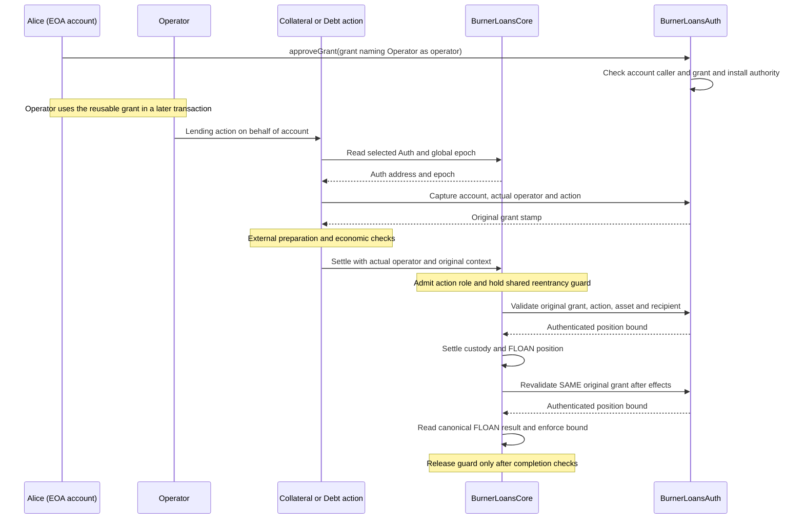
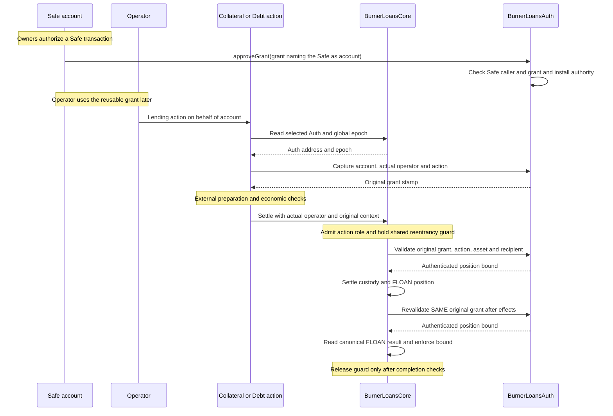
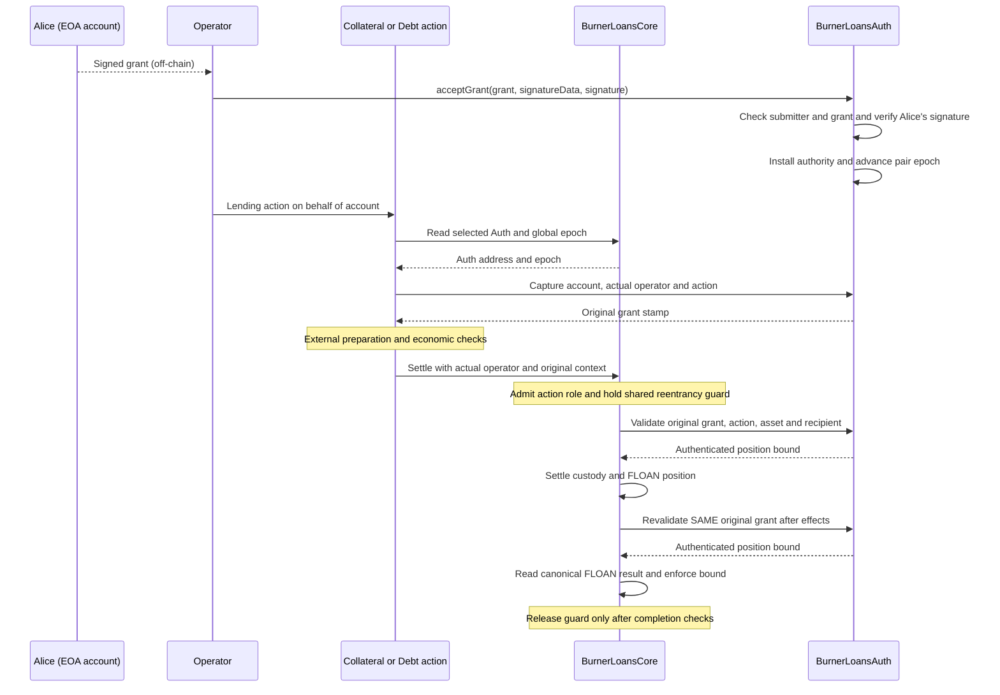
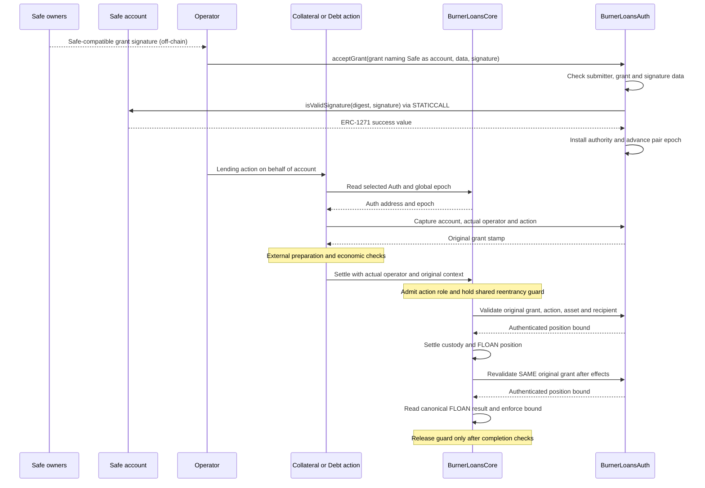
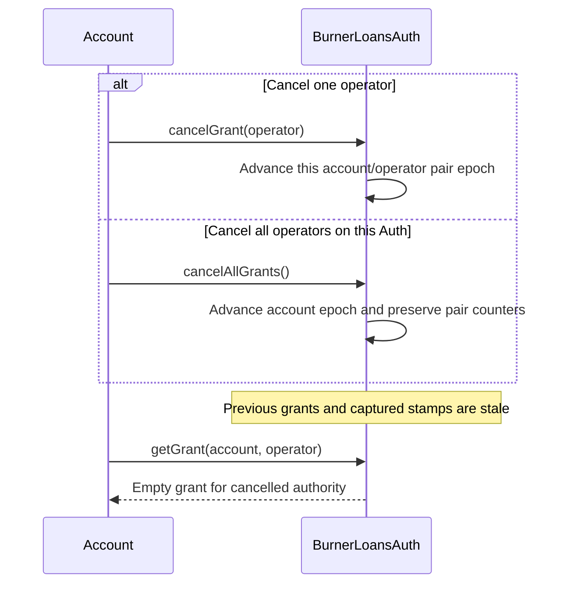
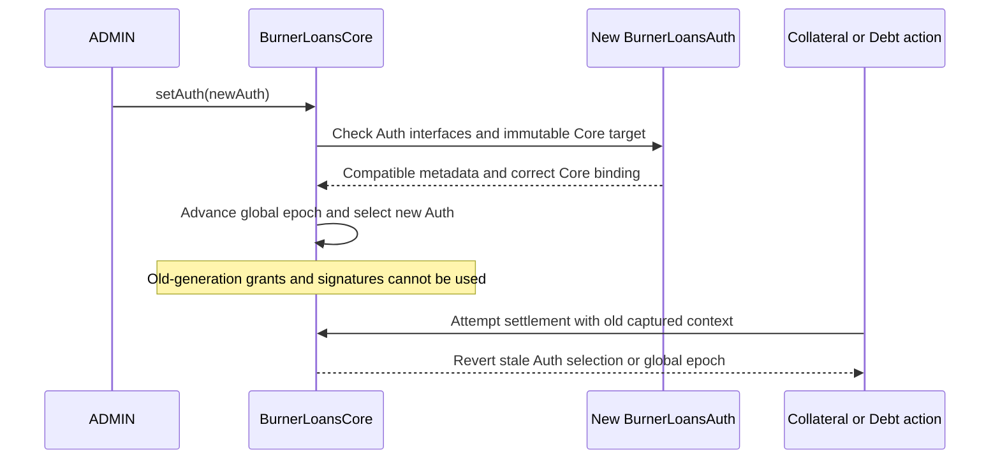

# Operator authorization

`OperatorAuth` lets an account authorize an operator for selected actions. It owns grant storage,
signatures, expiry and cancellation. Consumers define their permission data and can add signing or
key context through virtual functions. Its unreleased public API is `IOperatorAuth`.

Burner Loans uses `BurnerLoansAuth is OperatorAuth` to keep authorization code outside
`BurnerLoansCore`. Auth owns grants and account/operator counters. Core retains custody, settlement
and canonical resulting-position checks. See the [Burner Loans guide](burner_loans.md) and
[access-control reference](burner_loans_access_control.md) for the surrounding system.

## Flows at a glance

These diagrams show the current Burner Loans integration. Auth owns authorization state; Core
owns custody and checks the actual resulting position. An operator is the public action's actual
caller, not the action contract that calls Core.

### Reading the examples

Each example starts with granting authority and continues through an operator's lending action.
The operator calls Collateral or Debt; that admitted action calls Core. Core's caller is therefore
the action contract, while the operator's identity is forwarded separately and checked by Auth.

These examples use reusable grants (`multiple = true`), so approval and use may be separate
transactions. Temporary grants use the same checks but acceptance and use must share one
transaction. All grants include the current account/pair epochs, deadline, action mask,
permissions and Core context. Acceptance advances the pair epoch once; lending calls do not.

### EOA account: direct approval, then operator use

Alice sends an ordinary transaction to Auth's `approveGrant`. Alice is both the caller and the
grant's account, so Auth needs no separate grant signature. Operator later uses the accepted grant.



### Safe account: direct approval, then operator use

The Safe's owners authorize a Safe transaction that calls `approveGrant`. Auth sees the Safe
itself as `msg.sender`, matching the grant's account. Auth does not call ERC-1271 on this path;
the Safe has already authorized its own transaction.



### EOA account: signed acceptance, then operator use

Alice signs the grant off-chain for this Auth's chain-bound signing domain. Operator submits it to
`acceptGrant`. Auth verifies that Alice signed it before installing authority. Alice does not
need to send an approval transaction herself.



### Safe account: signed acceptance, then operator use

A Safe is a contract account: its address has no private key that Auth can recover from a
signature. ERC-1271 is the interface for asking the account contract, **"Does your signing policy
accept this signature for this message?"** Auth calls `isValidSignature(digest, signature)` on
the Safe, which checks the supplied signature according to its signing policy.

This is a read-only `STATICCALL`: the wallet cannot write state during validation. Auth requires
the ERC-1271 success value before installing the grant or advancing its pair epoch. A rejection
or failed validation reverts acceptance. This wallet check happens once at acceptance, not on
every lending call.



The account uses direct approval; signed acceptance is submitted only by the designated operator.
All four paths install the same form of authority. Signatures are not stored; the acceptance event
includes the permission hash rather than full permission bytes. A later change to a Safe's signing
policy does not revoke an already accepted grant; the account must cancel it or let it expire.

In each lending flow, Core checks the captured Auth address and global epoch both before and
after effects. Auth verifies the same original grant and returns the selected limit; Core reads
the actual FLOAN position and enforces that limit while its guard is held. Cancellation or grant
replacement during a callback makes the original authority stale and reverts settlement.

Owners acting on their own positions need no grant and bypass delegated bounds, but still obey
Core's ordinary rules and original Auth-selection checks. Repayment and liquidation retain their
separate admission rules.

### Cancel authority

The account cancels on the Auth instance that owns the grant. Cancellation remains available when
Core is disabled/inactive or that Auth is retired. It does not enumerate operators or delete old
permission storage.



Targeted cancellation does not invalidate every pre-signed future pair epoch. Account-wide
cancellation invalidates signatures with the old account epoch, including future pair epochs.
Cancellation on one Auth does not cancel signatures targeting another Auth.

### Replace the selected Auth

ADMIN selects a compatible Auth permanently bound to this Core. Core advances its global epoch on
every successful selection, so returning from A to B to A cannot revive A's old grants. Auth keeps
its local counters; accounts must approve again using the new context.



Replacement requires active Core and uses its shared guard; it is allowed while Core is locally
disabled. Interface checks prove compatibility, not honesty: governance must select a trusted
verifier. Auth holds no tokens, allowances or settlement permissions.

## Accounts, operators and actions

An account has intrinsic authority over its own position. It needs no self-grant. Explicit
self-grants and zero account/operator identities are rejected. Unsupported action checks fail even
for the account owner.

Actions are an unordered allowlist, not selectors or an operation cursor. Burner Loans uses:

| Action | Bit |
| --- | --- |
| Deposit collateral | `0x01` |
| Borrow OHM | `0x02` |
| Withdraw collateral | `0x04` |
| Extend maturity | `0x08` |

For example, `0x03` permits deposits and borrowing in any order, repeatedly while authority is live.
It does not mean two operations. A check accepts one supported bit; zero and composite checks are
invalid. Empty masks and unsupported grant bits are invalid.

Repayment remains permissionless at the public-action layer. Seizure keeps its independent
admission and economic rules. Neither operation needs a borrower grant.

## Grant data

| Field | Meaning |
| --- | --- |
| `account` | Account granting authority |
| `operator` | Operator authorized to act for that account |
| `accountEpoch` | Account cancellation epoch expected at acceptance |
| `pairEpoch` | Account/operator epoch expected at acceptance |
| `deadline` | Inclusive authorization deadline, in Unix seconds |
| `multiple` | False for accepting-transaction authority; true for reusable authority |
| `actions` | Consumer-supported action allowlist |
| `context` | Consumer-specific live namespace; zero for the default consumer |
| `permissions` | Canonical consumer-defined permission bytes |

Deadline comparisons use the full current timestamp. The implementation does not narrow that
timestamp before comparing it. Numeric zero limits remain literal zero limits.

`getGrant(account, operator)` returns only a live grant in the current namespace, or an entirely
empty grant when absent, expired or invalidated by cancellation/replacement. Deadline equality
remains live. Use `captureAuthorization` or `validateAuthorization` to establish
current authority. Authorization does not prove that an operation passes its economic or custody
checks.

## Temporary and reusable authority

`multiple` is false when an initialized grant leaves that field unset. Temporary authority exists
only in the transaction accepting the grant. Each permitted action may occur repeatedly, in any
order, during that transaction. The grant cannot survive a second transaction, even in the same
block. It uses transaction-local storage rather than a block-number expiry stamp.

A standalone temporary approval therefore leaves no authority for a later transaction. An operator
contract can accept a signed grant and call public actions in one transaction. A Safe can directly
approve a temporary grant and invoke the designated operator route in its own account transaction.
The route must preserve the operator identity named in the grant. This guide does not implement a
bundler or adapter.

Set `multiple = true` for prior approvals. Reusable authority remains valid through its inclusive
deadline until replacement, cancellation or live-context invalidation. This supports prior Safe
approvals and unattended operator workflows. Neither mode creates a transaction spending budget
or a count of permitted operations.

## Epochs and cancellation

Each Auth instance owns one account epoch per account and one pair epoch per account/operator.
Accepting a grant at pair epoch N advances that pair to N+1 once, before any operation. Later uses
do not advance it again. At most one current grant per pair is usable, including across custom
record namespaces.

These counters are independent of custom key context. Moving to another namespace cannot restart
a pair sequence or evade cancellation. Exhaustion reverts instead of wrapping.

| Call | Effect |
| --- | --- |
| `cancelGrant(operator)` | Advances the caller's pair epoch, invalidating its current grant and captured contexts |
| `cancelAllGrants()` | Advances the caller's account epoch without enumerating operators or resetting pair counters |

Cancellation need not delete historical permission bytes. It remains callable while BurnerLoans
Auth is retired or Core is disabled/inactive; cancellation does not query Core readiness. There is
no operator self-renunciation function.

Targeted cancellation does not invalidate every signature deliberately prepared for a future pair
epoch. Account-wide cancellation rejects signatures carrying the old account epoch, including
future pair/global epochs within that Auth. Neither operation can determine when a signature for
a deliberately future account epoch was signed.

Cancellation is scoped to the Auth instance. Alice can sign for future Auth B, then call
`A.cancelAllGrants()`. That does not cancel her B-domain request. B can later accept it if selected
and its signed context, epochs and other conditions match. Clients must show the Auth instance being
cancelled: a successful cancellation on retired A does not revoke current B authority.

## Direct approval

The account calls `approveGrant(grant)` itself. `msg.sender` must equal `grant.account`. EOAs and
Safes can use this path without ERC-1271 verification.

Read `accountEpochs(account)`, `pairEpochs(account, operator)` and
`authorizationContext(account, operator)` from the intended Auth before constructing the grant.
Use the pair epoch before acceptance. Another acceptance or cancellation can make the request stale
before submission.

For Burner Loans, obtain the selected Auth/global epoch from `Core.authConfig()` and verify
`Auth.core()` against the intended Core. Grant transactions target Auth rather than Core. Public
Collateral/Debt inputs do not require permission bytes or epochs on every action; those actions
capture original authority internally.

## Signed acceptance and hashing

The account can sign a grant for its operator to forward through
`acceptGrant(grant, signatureData, signature)`. Only the designated operator may submit
it. An unrelated caller cannot consume an acceptance epoch by forwarding a leaked signature.

The EIP-712 domain has exactly these fields:

```text
EIP712Domain(uint256 chainId,address verifyingContract)
```

`verifyingContract` is Auth, not Core. The fixed grant type is:

```text
Grant(address account,address operator,uint256 accountEpoch,uint256 pairEpoch,uint48 deadline,bool multiple,uint8 actions,bytes32 context,bytes32 permissionsHash,bytes32 signatureDataHash)
```

The signed message contains `keccak256(grant.permissions)` as `permissionsHash` and
`keccak256(signatureData)` as `signatureDataHash`. The calldata grant contains the raw permissions.
Signing clients must construct the hashed fields explicitly rather than sign the calldata struct
unchanged. The complete byte contents are authenticated, including nonempty signature-only data.
No name or version field is added to this domain.

The struct hash is `keccak256(abi.encode(typeHash, account, operator, accountEpoch, pairEpoch,
deadline, multiple, actions, context, permissionsHash, signatureDataHash))`. The final digest is
`keccak256(abi.encodePacked(hex"1901", DOMAIN_SEPARATOR(), structHash))`. The packed digest contains
only a fixed two-byte prefix and two fixed 32-byte hashes; dynamic permission/extension encoding
must not be replaced with ambiguous packed data.

EOA validation checks the signature against the account. ERC-1271 calls the account statically,
before grant installation and pair-epoch consumption. Signature bytes are not stored. Later uses
validate the accepted grant rather than rechecking its signature. Changing a wallet's signing
policy does not automatically revoke accepted authority.

### Acceptance-only signature data

The base accepts empty signature data and rejects unsupported nonempty data. A consumer override
defines its canonical schema/version, maximum length and acceptance conditions. The base hashes
the complete bytes into the fixed signature envelope.

BurnerLoansAuth accepts only empty signature data. `Grant.deadline` is its only expiry: the same
inclusive deadline applies to acceptance and every later use. Conditions required for both direct
and signed approval belong in shared creation or permission validation.

Data needed to interpret permissions later must remain in the authenticated grant or live context.
It cannot be discarded as signature-only metadata.

## Virtual extension points

| Hook | Consumer responsibility |
| --- | --- |
| `_currentAuthorizationContext(account, operator)` | Return the live namespace; default is zero |
| `_validateSignatureData(grant, signatureData)` | Validate bounded canonical acceptance-only data; default is empty-only |
| `_validatePermissions(grant)` | Define and validate the consumer's bounded permission schema |
| `_beforeGrantCreation()` | Apply consumer admission before installation |
| `_beforeAuthorization()` | Apply consumer admission to operative authorization checks |

Zero context is a real namespace, not a wildcard. A default consumer needs no external target,
Core pointer or global epoch. BurnerLoansAuth overrides the live-context hook with a typed
commitment to its immutable Core target and Core's current epoch from `authConfig()`.

The base retains mandatory signed fields, identity-prefixed keys, nonce mutation and installation
ordering. Hooks add data or conditions; they do not replace the complete digest or remove the
account/operator prefix from keys. Use typed unambiguous encoding for custom context.

A namespace-scoped key can commit the accepted context without a duplicate record field. Capture
and completion must retain that original key/context. A missing current record cannot fall back
to historical permission bytes, and old bytes cannot be relabeled with the current context.
Permission changes require a fresh acceptance epoch.

A generic context changing X to Y to X can make an old X record usable again if its epochs remain
current. A consumer needing irreversible revocation must supply monotonic context or advance
cancellation epochs. Burner Loans uses Core's checked monotonic global epoch.

Signing domain and live context have different purposes. A chain-ID change affects new signature
verification; it does not automatically move an accepted grant to a new storage key. Accepted
BurnerLoans grants retain their agreed lifetime across chain-ID and wallet-policy changes.

## Burner Loans permissions

`IBurnerLoansAuth.Permissions` occupies exactly 320 ABI bytes in this field order:

```text
depositAsset, maxCollateral,
borrowAsset, borrowRecipient, maxDebt,
withdrawAsset, withdrawRecipient, minCollateral,
extendAsset, maxMaturity
```

| Action | Fields | Limit on the resulting canonical position |
| --- | --- | --- |
| Deposit | asset, uint128 maxCollateral | Maximum credited collateral after DepositManager rounding |
| Borrow | asset, recipient, uint128 maxDebt | Maximum total principal due in raw 9-decimal OHM units |
| Withdraw | asset, recipient, uint128 minCollateral | Minimum collateral remaining after withdrawal |
| Extend | asset, uint48 maxMaturity | Maximum resulting absolute maturity timestamp |

Each selected record requires an explicit configured asset. A zero asset is not a wildcard.
Unselected records impose no constraints and are not asset-validated. Borrow and withdrawal have
independent optional recipients: zero permits any otherwise-valid recipient; a nonzero address must
match exactly. Independent asset fields prevent a limit expressed in one asset's units from being
reused for another asset.

Numeric maxima permit unrestricted bounds. Zero remains literal: a zero debt cap permits no
positive principal, while a zero withdrawal floor imposes no positive minimum. Owners bypass
delegated limits while ordinary lending rules still apply.

For example, a maximum resulting principal of `100e9` means 100 OHM with 9 decimals. If 95 OHM is
already due, borrowing another 10 OHM crosses that bound. It is not a per-call 100 OHM budget.
Collateral limits use actual credited asset units, not nominal vault transfers. Preview estimates
and caller-supplied result numbers are not authoritative. These examples do not select market
parameters or assume that collateral assets share decimals.

## Settlement and trust

Public actions capture the selected Auth, Core global epoch and grant stamp before external
preparation, including price/cache/vault calls. They forward their actual public caller and that
original context to Core. Core's `msg.sender` is normally the action contract, not the operator.

Core admits the operation-specific settlement role, checks the original Auth/global selection and
validates actual asset/destination before effects. It settles custody and FLOAN under its shared
guard, revalidates the same original authority after effects, reads canonical FLOAN state and
enforces the selected bound before releasing the guard. Protected settlements have no
metadata-free overload.

| Component | Trusted responsibility |
| --- | --- |
| Reviewed action | Forward the actual caller and original context; apply economic preparation/checks |
| Selected Auth | Authenticate accounts/operators and interpret permissions honestly |
| Core | Preserve original selection, custody, guard and canonical resulting-position checks |
| Governance | Select reviewed Auth and action implementations with correct bindings |

Auth stores an independently supplied immutable Kernel as its trust anchor. It checks Core's
reported Kernel against that address, actual membership in that Kernel, and canonical enabled-state
metadata through `PolicyDependency`. It trusts its immutable Core for current Auth selection, global
epoch and configured assets.
Interface/binding probes establish compatibility, not verifier honesty. ADMIN installing malicious
Auth can compromise authorization through legitimate action contracts.

Permissionless capture/validation views return facts; their return values are not bearer authority.
Public actions must still forward their actual caller and Core must independently admit the action.
Auth holds no collateral, OHM, receipt tokens or token allowances. Core remains the FLOAN facility
and DepositManager operator. Internal libraries/mix-ins compile into their consumer; their code
still counts toward that contract's deployed runtime.

## Auth replacement and lifecycle

`Core.setAuth` is ADMIN-only, requires active Core and uses its settlement reentrancy guard. Local
Core disablement permits replacement for recovery. Candidates require compatible Auth and Core-bound
interfaces and the immutable Core binding. Interface admission uses OpenZeppelin's
`ERC165Checker.supportsAllInterfaces`, including its positive and negative sentinel checks.
It accepts nonzero support words and trailing response data. Core binding retains canonical decoding
checks. Version metadata is not required or probed. An unchanged pointer or invalid binding is rejected.
Auth records the Kernel as an immutable identity anchor. It uses no Kernel roles and requests no
module permissions, so it does not need to be installed or activated as a Policy. It has no Enabler.

Every successful pointer change advances Core's private `_authEpoch`, including initial selection.
`authConfig()` returns the selected Auth and epoch together; neither has a standalone getter. Failure
rolls back the pointer, epoch and events. Core cannot enable/re-enable with Auth unset. A valid
startup order is Core deployment, activation while disabled, Core-bound Auth deployment, Auth
selection, then enablement after other prerequisites pass.

Deploy Auth with `new BurnerLoansAuth(address(trustedKernel), address(core))`; do not derive the
trusted Kernel from an untrusted Core report. The Kernel must be nonzero, and Core must already be
deployed, advertise `IBurnerLoansAuthTarget` through the standard ERC165 helper, and report that same
Kernel. Constructor binding uses `PolicyDependency.requireSameKernel`; malformed/unreadable Core
Kernel metadata and a foreign Kernel are rejected before the Auth can be selected. The target
interface has its own file. Construction does not require Core activity, local enablement or prior
Auth selection, and grants no Kernel permissions.

After Core migrates to another Kernel, the old Auth rejects the new binding even if the old Kernel
still reports Core active. Reinstall migrated modules and activate Core in the new Kernel, then
select a new Auth independently bound to that Kernel. The original Auth cannot be rebound, but its
local cancellation functions remain available. Other policies still need their own migration setup.

Creation and operative authorization require Auth selected and Core active/enabled. Local
cancellation bypasses those readiness checks. Changing Auth revokes current grants and signatures
for old global epochs. Returning A to B to A does not revive A's persistent or transient data. EOAs
and Safes must reapprove with the new context; each Auth retains its local counters on reselection.

Core preserves original Auth/global selection for owners too, even when their delegated stamp is
a sentinel. Rotation during preparation makes the context stale at settlement entry. Rotation
during settlement fails at Core's guard. A caught failure can leave the outer operation running;
propagation reverts it.

Grant cancellation or replacement can still change Auth epochs during callbacks. Completion
rejects the original stale authority. If Auth cancellation itself breaks, the account has no
independent Core cancellation endpoint; governed replacement revokes that Auth's current authority.

## Rollback examples

Rollback follows call frames:

1. A controller accepts successfully, then catches a later action failure. The earlier acceptance
   remains; a temporary grant may still be used during the rest of that transaction.
2. A frame accepts and later reverts. Its counter and permission installation both roll back.
3. A settlement callback cancels or replaces the grant. Core rejects the stale original context and
   settlement reverts. The callback mutation rolls back with that settlement.

A cancellation that must survive should be submitted outside a frame that later reverts.

## Client integration checklist

- Discover current BurnerLoans Auth/global context and verify its Core target.
- Build canonical permissions using that Auth's current account/pair epochs.
- Use Auth as the signing domain and authenticate both extension categories.
- Use temporary authority only when acceptance/use share one transaction; use reusable mode for
    prior approvals or later transactions.
- Treat stored-grant reads as data, not proof of liveness or economic executability.
- Show the Auth instance being cancelled and rediscover it after governance changes.
- Reapprove after Auth replacement and preserve actual operator identity through forwarders.

Clients use the public Collateral and Debt actions. Bundler3 support, adapters and flash routes
require separate integration work. No older authorization API is retained.

Authority belongs to the designated operator address. If it is a contract, that contract must
control who can cause it to call the actions. Granting reusable authority to a permissionless
forwarder lets its callers exercise that authority within the grant's bounds. First-party actions
authenticate their actual caller; they do not discover an end user behind another contract.

Result bounds are not a spending allowance consumed by use. For example, repayment can create room
for the authorized operator to borrow again within `maxDebt` before the same grant expires.

## Protected settlement requests

The public Collateral and Debt action signatures are unchanged. Their calls to Core use these
separate economic request types:

| Core method | Economic request fields |
| --- | --- |
| `settleDeposit` | `DepositRequest(asset, amount, payer, borrower)` |
| `settleWithdraw` | `WithdrawRequest(asset, amount, borrower, recipient)` |
| `settleBorrow` | `BorrowRequest(asset, borrower, payer, recipient, amount, maturity, protocolFee, referrer, referralFee)` |
| `settleExtend` | `ExtendRequest(asset, borrower, payer, maturity, protocolFee, referrer, referralFee)` |

Each method also takes the actual public operator and the original `AuthorizationContext` as
separate arguments. The action captures that context before mutable preparation. Core checks the
same Auth address, generation and grant stamp before and after settlement, then compares the
canonical FLOAN result with the grant's limit. A caller cannot use a publicly readable stamp to
bypass Core's own active/enabled checks or the operation-specific settlement role. Core does not
independently check the caller's policy membership; governance must revoke the old action's role
when retiring it. Approval of A→O and O→X does not authorize X for A.

Clients that call these protected methods must update their Core ABI. Repayment and seizure do not
receive a grant envelope.

## Gas and validation

Canonical 320-byte approval execution gas in the focused fixture: 108,758 temporary, 339,385 reusable,
and 350,650 for EOA signed acceptance. These exclude transaction intrinsic/calldata gas and vary with
warm storage, selected actions and wallet behavior. The ERC-1271 mutation-probe mock cost 401,349;
that is not a Safe estimate.

Temporary grants use OpenZeppelin transient-slot helpers and native ABI encoding without custom
assembly. This adds 15,216 gas to the measured temporary approval compared with the previous codec.

Scoped Astra adversarial review found no confirmed exploit; the separate Ponytail simplicity review
accepted the responsibility split. Neither is a production audit. Focused tests cover canonical
results, real callbacks, rollback and vault rounding. Cancellation and identical-permission
replacement are exercised during borrowing fee collection, principal delivery and extension fee
collection as well as deposit/withdraw callbacks. Actual node transactions also verify temporary
authority across returning call frames and reject a second transaction in the same block.

The DevBox whole-repository attempts ended with solc SIGKILL. Before the backing-oracle integration,
serial Mac validation on base `2f7f225a1b` passed all 14,302 non-fork unit tests across 925 suites,
with zero failures or skips. That run includes operator-only signed acceptance, the Kernel
zero-address check and the temporary-grant helper rewrite.
The Mac runs exposed duplicate-role fixture collisions. Deterministic regressions and idempotent role
setup resolved them before the successful reruns.

After rebasing onto `a9646dd375`, focused validation passed 5,318 non-fork tests across 359 suites,
with zero failures or skips. It covers Burner Loans, BackingOracle and generic OperatorAuth.
That run preceded the asset-error and scenario-ownership review changes, which passed focused
Auth, constructor and Core settlement checks. The rebase validation also passed sixteen invariant
properties in fifteen campaigns of 64 runs and 64 calls per run; focused review rechecked Auth and Core.
All 128 Auth and upstream integration scenario documents pass their test-mapping checks.
The 101 Solidity files touched by this branch have no Forge lint warnings or errors. The final independent
review found no actionable defects. Fork and proposal suites remain unverified.

The final request-struct candidate was also deployed on a strict local Prague node with actual
Kernel, ReceiptTokenManager, DepositManager and mock principal-token constructors. All four runtime
lengths matched their artifacts. This checks deployment limits and bindings; it is not a production
installation or a fork test.

Additional regressions cover genuine owner/operator stamps presented by unadmitted settlement
callers, cross-account and cross-operator stamp substitution, non-transitive delegation and malformed
EOA/ERC-1271 replacements. Rejected replacements preserve the complete existing grant and both
epochs. These checks complement the public action's unrelated-caller and callback tests.

Historical fixed-fixture gas comparison before and after the request refactor, before the
trusted-Kernel follow-up:

| Fixture | Before | After | Change |
| --- | ---: | ---: | ---: |
| First collateral deposit | 770,107 | 727,976 | -42,131 |
| First borrow | 1,765,468 | 1,578,361 | -187,107 |
| Partial collateral withdrawal | 1,046,526 | 1,002,034 | -44,492 |
| One-term extension | 2,432,271 | 2,140,282 | -291,989 |

These are complete test-fixture measurements, including fixture calls. The gas test and shared
modular fixture sources were identical between that archived baseline and request-refactor run. These values
are not transaction estimates or isolated action-call costs.

### Cancellation input validation and compiler compatibility

`cancelGrant` rejects a zero operator with `OperatorAuth_InvalidIdentity` and the calling account as operator with `OperatorAuth_SelfGrant`, matching grant creation. Valid cancellations remain available regardless of Core readiness. OperatorAuth uses transient storage and requires Solidity 0.8.34 or newer; the project compiler remains pinned to 0.8.36.

A direct approval supplies expected epochs and context. A Safe transaction collected before cancellation or Auth rotation consequently reverts if executed afterwards; it does not silently approve against newer authority. Clients should refresh and rebuild stale approvals.

`getGrant` filters expired and cancelled records without deleting their underlying storage. It also hides stale reusable records after a temporary replacement ends. It returns an entirely empty grant when no live record exists; intrinsic owner authority requires no grant.

`GrantAccepted` emits grant metadata and `permissionsHash = keccak256(permissions)` instead of the permission bytes to reduce log gas. The event account/pair epochs are the expected pre-acceptance values; acceptance advances the pair counter by one. Clients can compare the hash with bytes obtained from acceptance calldata or the live getter. The hash cannot recover the bytes or establish live authority, and is not an indexed topic. Clients needing historical permissions should retain acceptance calldata.
