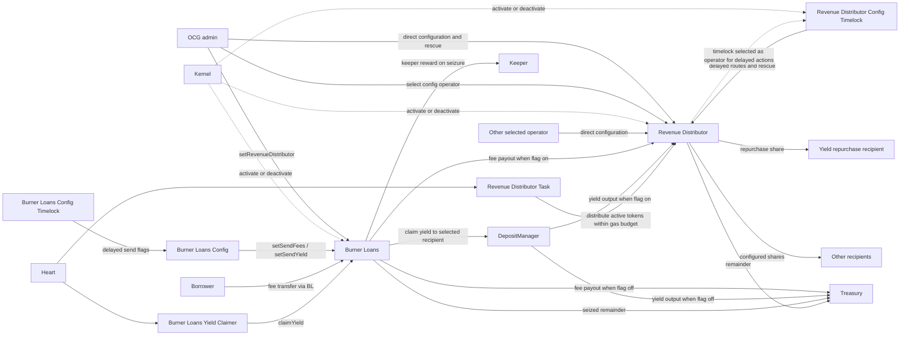

# Revenue Distributor

Revenue Distributor allocates received ERC-20 tokens between a repurchase recipient, configured
recipients, and Treasury. Source contracts send ordinary transfers; the distributor does not
convert tokens, track receipt sources, or distribute automatically on receipt. USDS and sUSDS
need separate routes because they are different tokens.

## Contract linkages

See [access control](revenue_distributor_access_control.md) for caller permissions and lifecycle gates.

## Routes and settlement

`setAssetRoutes(asset, repurchaseBps, routes)` activates a token or replaces its route for future
receipts. Configured recipients need positive shares and distinct addresses; zero, the distributor,
the Kernel, current Treasury, and current yield recipient are forbidden. The combined configured and repurchase shares cannot exceed 10,000 basis points. Each share rounds
down; Treasury receives the exact remainder, including rounding dust. A Treasury-only route is valid.
There is no explicit asset or recipient count cap; check route gas before activation.

Setting a nonzero repurchase share requires an enabled, Kernel-active yield recipient implementing
`IYieldRepurchaseRecipient`. The asset must match an enabled vault's shares or underlying token.
`setYieldRecipient` validates every active route and any unpaid repurchase shares, including retired
assets. Clearing it requires every active route to have zero repurchase share; existing repurchase
debt then follows Treasury. A new recipient cannot be current Treasury or a configured recipient on
an active route. Even selecting the same yield recipient revalidates these requirements.

Anyone can call `distribute(asset)` while the distributor is enabled and Kernel-active and the asset
route is active. It allocates only custody above the total pending reserve, then attempts payment
to the current repurchase, configured, and Treasury destinations. These are ordinary token transfers.
A transfer that reverts or returns false leaves that amount owed without blocking other recipients.
`Distributed` records each successful nonzero payment; `DistributionDeferred` records failed attempts. Zero amounts cause
no transfer or payout event. Custody below the reserve reverts distribution.

`disableAssetRoutes(asset)` retires the asset, removes it from periodic settlement, and clears its
route. Existing debt stays owed. Retirement never makes the token eligible for surplus rescue;
new receipts remain held until governance activates a route again.

## Pending payouts

| Liability | Recipient after configuration changes |
| --- | --- |
| Configured share | Original fixed address, even after removal from the route |
| Repurchase share | Current yield recipient; current Treasury if it is cleared |
| Treasury remainder | Current TRSRY module |

`pendingPayout(asset, recipient)` combines every liability currently owed to that address.
`getPendingPayoutAssets()` and `getPendingPayoutRecipients(asset)` identify outstanding obligations;
recipient addresses are listed once even when roles overlap. Anyone can retry the combined amount
with `transferPendingPayout(asset, recipient)`, including for retired assets, while the distributor
is enabled and Kernel-active. Failed retries preserve the debt; successful retries clear it.

`distribute` also retries current route and role destinations, so Heart can retry those payouts on
later beats. Retired assets and former recipients outside those destinations need direct retries.
Burner Loans' own pending payouts are retried separately in Burner Loans.

Treasury upgrades refresh the distributor's cached TRSRY address. If a configured recipient becomes
Treasury, its fixed share and the Treasury liability combine in one payment. With no new receipts,
`distribute` can settle that debt. With new receipts, the overlapping route must first be corrected.
For example, 50 owed to recipient X plus 50 owed to Treasury becomes 100 owed to X if X becomes
Treasury; no token is allocated twice.

## Periodic task

Heart calls `RevenueDistributorTask.execute()`. It visits active assets within `executionGasLimit`,
isolates each distribution failure, and advances its cursor past attempted assets. When the budget
runs low, the next beat resumes at the first unattempted asset. The task checks gas before looking
up an asset and preserves `gasReserve` before calling the distributor. A failed asset can be retried
on a later pass or directly through `distribute`. A token exhausting call gas can revert that asset's
distribution. Failure of the whole task body rolls back its work and emits `ExecutionFailed`.

An authorized Heart call does no work while the task or distributor is disabled or Kernel-inactive.
Admin or `revenue_distributor_admin` can tune the gas budget, minimum attempt threshold, and reserve,
or reset `setNextAssetIndex(index)`, including while the task is disabled; the task must remain
Kernel-active. Index zero is always accepted, and other indices must identify a current active asset.
The cursor wraps to fit the current asset set if it shrinks.

## Rescue

Admin or the selected config operator can call both rescue functions while the distributor is
Kernel-active, including while it is locally disabled. If the selected timelock is unavailable,
admin can rescue directly. Ordinary receipts remain possible while disabled or Kernel-inactive.

| Function | Behavior |
| --- | --- |
| `rescue(asset, destination)` | Transfers the full live balance of a never-listed token. Zero surplus succeeds without a transfer or `AssetRescued` event. Active and retired managed tokens are rejected. |
| `rescuePendingPayout(asset, recipient, destination, amount)` | Redirects an exact positive amount up to the recipient's combined entitlement. Debits configured share, repurchase, then Treasury; transfers the total once. |

Both reject tokens without contract code and destinations equal to zero, the Kernel, the distributor,
or the token. Pending rescue also rejects a zero original recipient. Each nonzero pending debit
emits `PendingAssetRouteRescued`, `PendingRepurchaseRescued`, or `PendingTreasuryRescued` in debit
order. Other recipients' entitlements remain unchanged, including any separate debt owed to the
destination. A failed rescue transfer reverts all balance, liability, and event changes.

The permissionless `previewRescue*` calls validate inputs and return current availability. They share
rescue's Kernel-active requirement and allow local disablement; they do not guarantee future token
transfer success or freeze custody, entitlement, or routing.

## Configuration and timelock

Admin or the selected operator can configure routes and the yield recipient while the distributor
is enabled and Kernel-active. Admin can rotate or revoke the operator while locally disabled, but
must keep the distributor Kernel-active. Selecting `RevenueDistributorConfigTimelock` adds a delay
for delegated actions. Direct admin calls use the delay, if any, of the admin role holder.

Admin or `revenue_distributor_admin` can queue configuration and either rescue action. The timelock
must be enabled, Kernel-active, and selected as operator at queueing and execution. The distributor
must be Kernel-active; only rescues allow it to be locally disabled. Anyone can execute during the
three-day window after the configured delay. The shared queue and Revenue Distributor validation
support delays from 1–30 days. The current `RevenueDistributorConfigTimelock` constructor selects
one day and exposes no public delay setter; a future implementation may expose the inherited
internal setter within the same bounds. Emergency can cancel unfinished actions while the timelock
is enabled and Kernel-active, even if the distributor or operator is unavailable.

Route changes, retirement, and both rescues share one key per asset; yield-recipient changes use a
separate global key. Conflicting actions cannot be queued together. Route actions bind the current
asset state, route, and yield recipient; recipient changes bind the current recipient. Rescue binds
only asset state, so new receipts do not stale it. Surplus rescue sweeps the balance at execution;
pending rescue rechecks the stored recipient and amount against live entitlement.

Execution also rechecks live dependencies. A yield recipient becoming disabled, inactive, or unable
to accept an asset can block a queued configuration even when its state hash is unchanged. Failed
execution retains the action and keys; it can be retried within the original window after restoring
valid state. Batches execute atomically. Separate actions can invalidate each other; stale actions
may need cancellation and requeueing. See [batch queue](config_timelock_batch_queue.md).

## Retirement and wind-down

Stopping an asset route does not stop tokens from arriving. ERC-20 transfers have no callback that
lets the distributor reject or attribute a late receipt, and an asset remains managed after its
route is retired. Use this sequence when retiring one asset:

1. Stop every known source from sending the asset. For Burner Loans, disable the applicable fee or
   yield flag through Burner Loans Config, cancel or let expire any queued action that could enable
   it again, and confirm that the effective flag is false before proceeding.
2. While the route remains active and the distributor remains enabled and Kernel-active, call
   `distribute(asset)` to allocate the live unreserved balance.
3. Retry each address returned by `getPendingPayoutRecipients(asset)`, or use governed pending-payout
   rescue when the original recipient cannot accept payment.
4. Call `disableAssetRoutes(asset)` only after expected receipts and liabilities have been handled.
   Retirement removes the asset from periodic settlement and clears its route; it does not erase
   unpaid liabilities or make the token eligible for surplus rescue.

If tokens arrive after retirement, activate a valid route again and call `distribute`. A retired,
previously managed asset cannot be swept with `rescue`. Direct pending-payout retries remain
available for its existing liabilities while the distributor is enabled and Kernel-active.

For a complete distributor wind-down, first disable every source route, settle all active-asset
balances, and clear or rescue every listed pending payout. Then retire the routes, clear source
pointers where applicable, and disable the periodic task. Keep the config timelock available until
all delayed route and rescue work is complete. Disable and Kernel-deactivate the distributor only
after its managed balances and liabilities are zero and no further receipts are expected: local
disablement stops `distribute` and ordinary pending retries, while Kernel deactivation also blocks
rescue until governance reactivates the policy.

## Rollout

Deploy and activate the distributor, its config timelock, and its task. Enable the distributor,
then configure the yield recipient and exact fee and yield output tokens. Select and enable its
config timelock if delayed delegation is required, grant
`revenue_distributor_admin` to queue proposers, and enable the periodic task. Once Burner Loans is
enabled, set its distributor address and enable the desired fee and yield flags through Config or
its timelock. Run the yield claimer before the distributor task in Heart and size gas against the
largest intended route. Verify the admin role holder: operator rotation is immediate at the target,
so governance delay depends on that role's assignment.

Existing Convertible Deposit Facility contracts send yield to Treasury through a fixed destination.
Routing their yield here requires a modified facility and redeployment recognized by its integrations.
