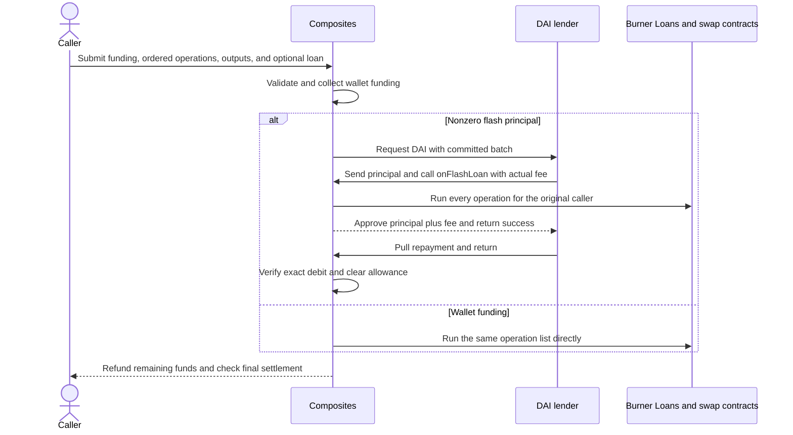

# execute and executeWithGrant

Sources: `IBurnerLoansComposites`, `BurnerLoansComposites`, `IOperatorAuth`,
`BurnerLoansAuth` and the real modular lending fixture.

This is the shared acceptance matrix for both execution entries.
Read the single-operation proofs first, then sequences, operation failures, grants, numeric
boundaries and execution-wide protections. Signature-only admission cases are kept here too.
All execution scenarios live here; there is no separate executeWithGrant scenario document.

## Scope and test modes

The executor supports Deposit, Borrow, Repay, Withdraw and Extend, plus `ConvertDaiUsds`,
`SwapExactInput` and `SwapExactOutput`. A separate batch parameter enables a single optional DAI
flash loan. Exchange-only execution can run without lending authority. All token-moving operations
use typed inputs and fixed dependencies.

A is the submitting account, position owner and wallet payer; E is Composites. Ordinary undelegated
EOAs work with existing reusable authority or inline signed authority. The shared mode fixture
uses an optional ERC-1271 account so direct temporary approval and execution can occur atomically;
this does not replace the separate EOA proofs. There is no borrower or payer override.

Each shared operation test fuzzes `inlineGrant` and `multiple` independently:

| Mode | Grant acceptance | Execution entry | Lifetime |
| --- | --- | --- | --- |
| Direct reusable | Account calls Auth.approveGrant in an earlier transaction | execute | Survives until expiry/cancellation/replacement |
| Direct temporary | Account calls Auth.approveGrant then E in one account transaction | execute | Accepting transaction only |
| Inline reusable | E forwards the account-signed complete grant to Auth | executeWithGrant | Survives for later execute calls |
| Inline temporary | E forwards the account-signed complete grant to Auth | executeWithGrant | Accepting transaction only |

These four modes are **G** below. A temporary grant permits several operations and repeated actions
in its accepting transaction; it is not a one-operation allowance. A plain EOA cannot approve a
temporary grant in one transaction and use it in another. Signed-entry-specific cases use that
entry directly. Repayment has a separate no-grant proof.

Default fixtures: dependencies active/enabled; six-decimal underlying collateral, nine-decimal
OHM; starting executor balances zero unless stated; grants admit all four delegated lending action
bits and the fixture asset. Amounts, funding, fees and minima are raw units. Lending amounts are
uint128, funding/fee/minimum amounts uint256, terms uint16, grant deadline uint48 and epochs uint256.
Future DAI/USDS/USDe routes use 18-decimal tokens.

**Unchanged** means execution restores canonical positions, Core/Inventory principal aggregates,
custody, caller/executor balances and Core allowances. Grant acceptance in the reverted execution
also rolls back; a direct reusable approval committed in an earlier transaction remains installed.
A revert commits no execution logs. Composites has a local owner-controlled pause and no Kernel membership. Downstream lifecycle checks remain authoritative. No executor preview is proposed.

## 1. Each lending operation succeeds alone

All rows require G. Each shared test checks the returned result, canonical position, actual custody,
Core/Inventory principal totals, executor remainders and cleared lending allowances.

| ID | Operation | Starting position | Input | Result and effects | Test |
| --- | --- | --- | --- | --- | --- |
| BLREX-P12 | Deposit | No collateral/debt | Fund 15e6; deposit 10e6 | Return credit and total collateral, both 10e6; refund 5e6 | Covered: [test][test_whenDepositAlone] |
| BLREX-P13 | Borrow | Collateral 2000e6; no debt | Fund 1e6 fee budget; borrow 100e9 to A | Principal 100e9; fee 312500 = 125e6 * 25 / 10000; refund unused budget | Covered: [test][test_givenCollateralPosition_whenBorrowAlone] |
| BLREX-P14 | Repay | Older debt 100e9; collateral 2000e6 | Fund/pay 100e9 OHM | Return remaining principal 0; Inventory burns exact minted repayment; collateral retained | Covered: [test][test_givenOlderDebt_whenRepayAlone] |
| BLREX-P15 | Withdraw | Debt-free collateral 2000e6 | Withdraw 2000e6 underlying to E | Exact output refunded to A; position/custody empty | Covered: [test][test_givenCollateralPosition_whenWithdrawAlone] |
| BLREX-P16 | Extend | Older debt 100e9; collateral 2000e6 | One term; independent fee 7; fund 10 raw collateral | Maturity +30 days; fee 7; refund 3; principal/collateral retained | Covered: [test][test_givenOlderDebt_whenExtendAlone] |

### Additional successful output/fee variants

These rows preserve the remaining accepted vault, recipient and fee-routing domains.

| ID | Caller | Condition / operation | Execution | Effects | Test |
| --- | --- | --- | --- | --- | --- |
| BLREX-P03 | A | Borrow and withdrawal use distinct grant-permitted recipients, with either payout going to A | Success | Each recipient receives its assigned token. E cannot reuse a direct payout | Covered: [test][test_givenCollateralPosition_whenGrantSpecifiesPayoutRecipient], [test][test_givenCollateralPosition_whenBorrowIsPaidDirectly_reverts] |
| BLREX-P04 | A | Borrow/withdraw to E | Success | Received outputs can fund later operations; final surplus refunded | Covered: [test][test_givenOlderDebt_givenReusableGrant_whenRepayAndWithdraw], [test][test_givenCollateralPosition_whenBorrowedOhmRepaysAnotherMarket], [test][test_givenCollateralPosition_whenWithdrawalFundsLaterDeposit] |
| BLREX-P05 | A | Extend with independently funded fee | Success | Canonical maturity advances; protocol/referral fee split unchanged | Covered: [test][test_givenOlderDebt_whenExtensionFeeHasReferral] |
| BLREX-P06 | A | Zero origination/extension fees, no fee funding | Success | Zero spending allowance and no extra wallet pull | Covered: [test][test_givenOlderDebt_whenBorrowAndExtensionAreFree] |
| BLREX-P07 | A | Withdrawal returns vault shares | Success with expected share token and raw minimum | Actual share amount refunded; pre-existing shares protected | Covered: [test][test_whenVaultSharesAreRefunded] |

## 2. Several operations execute in order

All ordinary sequences require G. Every intermediate lending check still applies.

| ID | Caller | Condition / operation | Execution | Effects | Test |
| --- | --- | --- | --- | --- | --- |
| BLREX-P01 | A, G | Deposit 2000e6 then borrow 100e9; fund 2100e6 | Ordered results and completion | Collateral 2000e6; principal 100e9; fee 312500; unused input refunded | Covered: [test][test_whenDepositThenBorrow], [test][test_givenReusableGrant_whenDepositAndBorrow] |
| BLREX-P02 | A, G | Repay older debt 100e9 then withdraw 2000e6 underlying to E | Both operations succeed | Principal/collateral/custody empty; exact withdrawn funds refunded | Covered: [test][test_givenOlderDebt_whenRepayThenWithdraw], [test][test_givenOlderDebt_givenReusableGrant_whenRepayAndWithdraw] |
| BLREX-P17 | A, G | Deposit 10e6 then withdraw 10e6 in the same execution | Both operations succeed | Starting wallet restored; no surviving position/custody | Covered: [test][test_whenDepositThenWithdraw] |
| BLREX-P18 | A, G | Three deposits of 1 raw unit in one execution | Three ordered results, one grant acceptance | Collateral/custody 3; temporary grant covers repeated actions | Covered: [test][test_whenRepeatedDeposits] |
| BLREX-P34 | A, G | Borrow 100e9 OHM against six-decimal collateral and use the proceeds to repay 100e9 OHM in an eighteen-decimal collateral market | Both operations succeed | Each market retains 2000 collateral tokens at its own raw scale. Only the source market's 312500 raw fee is paid | Covered: [fuzz][test_givenCollateralPosition_whenBorrowedOhmRepaysAnotherMarket] |
| BLREX-T03 | A, G | Deposit 10e6 then another 1 with only 10e6 funded | BurnerLoansComposites_InsufficientFunds(asset,1,0) | First deposit, custody and funding restored; grant rollback follows transaction boundary | Covered: [test][test_whenLaterDepositExceedsFunds_reverts], [test][test_givenSignedGrant_whenLaterOperationFails_reverts] |
| BLREX-T11 | A | Repay older debt then withdraw with minimum actual+1 | BurnerLoansComposites_InsufficientOutput | Earlier repayment and all custody/funding restored | Covered: [test][test_givenOlderDebt_whenWithdrawalCannotSettle_reverts] |
| BLREX-D04 | A | Borrow then repay same position in latest-borrow block | `BurnerLoans_SameBlockRepay(block)` | Entire execution unchanged | Covered: [test][test_whenBorrowThenRepaySameBlock_reverts] |

## 3. Grant and caller conditions for each operation

The position bounds below apply identically to authority already installed through Auth.approveGrant
and to a complete signed grant passed to executeWithGrant. Each new bound/recipient test fuzzes all
four G modes. The signature authenticates the grant; it does not change what its conditions mean.

Auth selects the action's granted bound. Core compares that bound with the actual canonical FLOAN
position after settlement, under its guard. Its existing `BurnerLoansCore_ResultOutsideGrant`
therefore reports a **grant violation**; Composites propagates that error unchanged.
Collateral bounds are raw collateral units (6 decimals in this fixture; 18 for USDS), debt bounds
are raw OHM units (9 decimals), and maturity bounds are absolute timestamps in seconds.

### Granted position bounds: separate happy and failure fuzz cases

Each operation has a distinct happy-path case and a distinct failure case. The grant bound is
fuzzed over the entire stated permitted/violating interval independently of direct/inline acceptance
and temporary/reusable lifetime. All other lending inputs remain usable. Canonical results are
fixed by the real lending fixture to isolate the grant comparison; this is grant-limit fuzzing,
not a claim that every operation amount or economic capacity is fuzzed (see section 5).

M128 = uint128.max; M48 = uint48.max. Deterministic seed drivers run every listed seed under all
four G modes, with EVM state restored between seeds. They retain the original equality/one-unit
regressions and add zero, one and type maxima in the relevant success or failure domain.

#### Deposit: maximum resulting credited collateral

| ID | Case | Position / operation | Fuzzed maxCollateral / guaranteed seeds | Execution / effects | Test |
| --- | --- | --- | --- | --- | --- |
| BLREX-P19 | Happy | Existing 400e6; fuzz deposit in [1, 600e6], seed 1 and 600e6 | [1000e6, M128]; seeds 1000e6, 1000e6+1, M128 | Credit and custody equal 400e6 plus deposit; exact deposit spent | Covered: [fuzz][test_givenCollateralBelowCeiling_whenDepositFitsGrantCeiling], [seeds][test_whenDepositGrantHappyBoundarySeeds] |
| BLREX-A13 | Failure | Existing 400e6; fuzz deposit in [600e6+1, M128-400e6], seed both endpoints | [0, 1000e6]; seeds 0, 1, 1000e6-1, 1000e6 | BurnerLoansCore_ResultOutsideGrant; position, custody and funding restored | Covered: [fuzz][test_givenCollateralBelowCeiling_whenDepositExceedsGrantCeiling_reverts], [seeds][test_whenDepositGrantFailureBoundarySeeds], [EOA][test_whenSignedCollateralConstraintExceeded_reverts] |

maxCollateral caps the resulting total, not the amount of this deposit. A deposit below 1000e6 can
still violate that ceiling when prior collateral is already credited.
With 400e6 already credited, M128-400e6 is the largest deposit whose resulting collateral fits `uint128`.

#### Borrow: maximum resulting OHM principal

| ID | Case | Position / operation | Fuzzed maxDebt / guaranteed seeds | Execution / effects | Test |
| --- | --- | --- | --- | --- | --- |
| BLREX-P20 | Happy | Healthy collateral 2000e6; debt 0; borrow 100e9 | [100e9, M128]; seeds 100e9, 100e9+1, M128 | Success; principal 100e9 delivered; canonical aggregates agree | Covered: [fuzz][test_givenCollateralPosition_whenBorrowFitsGrantDebtCeiling], [seeds][test_whenDebtGrantHappyBoundarySeeds] |
| BLREX-A15 | Failure | Healthy collateral 2000e6; debt 0; borrow 100e9+1 | [0, 100e9]; seeds 0, 1, 100e9-1, 100e9 | BurnerLoansCore_ResultOutsideGrant; no principal or fee committed | Covered: [fuzz][test_givenCollateralPosition_whenBorrowExceedsGrantDebtCeiling_reverts], [seeds][test_whenDebtGrantFailureBoundarySeeds], [EOA][test_whenSignedDebtConstraintExceeded_reverts] |

#### Withdraw: minimum remaining credited collateral

| ID | Case | Position / operation | Fuzzed minCollateral / guaranteed seeds | Execution / effects | Test |
| --- | --- | --- | --- | --- | --- |
| BLREX-P21 | Happy | Debt-free 2000e6; withdraw 1000e6; result 1000e6 | [0, 1000e6]; seeds 0, 1, 1000e6-1, 1000e6 | Success; remaining credit/custody 1000e6; output refunded | Covered: [fuzz][test_givenCollateralPosition_whenWithdrawalRespectsGrantFloor], [seeds][test_whenWithdrawalGrantHappyBoundarySeeds] |
| BLREX-A24 | Failure | Debt-free 2000e6; withdraw 1000e6+1; result 1000e6-1 | [1000e6, M128]; seeds 1000e6, 1000e6+1, M128 | BurnerLoansCore_ResultOutsideGrant; no collateral debit or payout committed | Covered: [fuzz][test_givenCollateralPosition_whenWithdrawBreachesGrantFloor_reverts], [seeds][test_whenWithdrawalGrantFailureBoundarySeeds] |

#### Extend: maximum resulting absolute maturity

M is the original maturity and R = M+30 days is the result of extending one configured term.

| ID | Case | Position / operation | Fuzzed maxMaturity / guaranteed seeds | Execution / effects | Test |
| --- | --- | --- | --- | --- | --- |
| BLREX-P22 | Happy | Older healthy debt; extend one term to R | [R, M48]; seeds R, R+1, M48 | Success; canonical maturity R; fee settled once | Covered: [fuzz][test_givenOlderDebt_whenExtensionFitsGrantMaturityCeiling], [seeds][test_whenMaturityGrantHappyBoundarySeeds] |
| BLREX-A25 | Failure | Older healthy debt; extend one term to R | [0, R-1]; seeds 0, 1, R-1 | BurnerLoansCore_ResultOutsideGrant; original maturity and fee funding restored | Covered: [fuzz][test_givenOlderDebt_whenExtendExceedsGrantMaturityCeiling_reverts], [seeds][test_whenMaturityGrantFailureBoundarySeeds] |

### Granted asset and recipient conditions: both grant paths

| ID | Operation | Granted condition | Attempted action | Execution / effects | Test |
| --- | --- | --- | --- | --- | --- |
| BLREX-A23 | Any grant-dependent action | Actual asset matches the selected grant asset | A different admitted asset is used | BurnerLoansAuth_AssetMismatch(expected,actual); Unchanged | Covered: [seeds][test_whenWrongAssetBoundarySeeds_reverts] |
| BLREX-A14 | Borrow | borrowRecipient = B | Borrow sends principal to A != B | BurnerLoansAuth_RecipientMismatch(B,A); no principal, fee or input committed | Covered: [test][test_givenCollateralPosition_whenBorrowRecipientViolatesGrant_reverts], [test][test_whenSignedRecipientConstraintDiffers_reverts] |
| BLREX-A28 | Withdraw | withdrawRecipient = B | Withdraw sends output to E != B | BurnerLoansAuth_RecipientMismatch(B,E); no collateral debit or payout committed | Covered: [test][test_givenCollateralPosition_whenWithdrawRecipientViolatesGrant_reverts] |

### Caller spending and output conditions

Borrow.maxFee and Extend.maxFee limit the combined protocol/referral fee for that operation in
raw collateral-asset units. The effective Core allowance is min(maxFee, current available funds);
unused funding is refunded. Funding.amount is an input budget, not an aggregate fee limit, because
operations also use it for deposits and repayment, and may reuse earlier outputs. The
FlashLoan.maxFee separately caps lender fees in raw DAI units.
Exact input specifies the debit and a minimum output. Exact output specifies the output target and
caps the actual input debit.
Final Output.minReturned requirements complement these operation limits; they do not isolate fees
from other spending. No execution-wide scalar adds fees paid in different tokens.

Repayment is permissionless and has no action bit or maxRepay field in the existing lending grant.
Its per-call amount comes from the submitting account's operation; spending is limited to explicit
wallet funding plus outputs made available by earlier operations. Protected starting balances and
unlisted wallet balances cannot fund a shortfall. A grant-level repayment ceiling would be a new
Auth/API requirement rather than a condition the current grant already carries.

| ID | Operation | Caller condition | Attempted action | Execution / effects | Test |
| --- | --- | --- | --- | --- | --- |
| BLREX-P23 | Repay | Fund the exact repayment amount; no earlier OHM output | Fuzz repayment in [1, 50e9] from debt 100e9; seed both endpoints | Success; principal falls by the repaid amount; remaining wallet OHM stays untouched; exact repayment burned | Covered: [fuzz][test_givenOlderDebt_whenRepayEqualsExplicitFunding], [seeds][test_whenFundedRepaymentAmountBoundarySeeds] |
| BLREX-T12 | Repay | Fund 50e9 OHM; no earlier OHM output; E starts with protected 20e9 | Fuzz repayment in [50e9+1, M128]; seed both endpoints | BurnerLoansComposites_InsufficientFunds(OHM,requested,50e9); debt unchanged; wallet funding restored; protected 20e9 retained | Covered: [fuzz][test_givenOlderDebt_whenRepayExceedsExplicitFunding_reverts], [seeds][test_whenUnfundedRepaymentAmountBoundarySeeds] |
| BLREX-T01 | Deposit | Protected starting funds cannot be spent | Deposit exceeds available execution funds | BurnerLoansComposites_InsufficientFunds; protected funds retained; wallet collection restored | Covered: [test][test_givenProtectedBalance_whenInputBudgetIsTooSmall_reverts], [test][test_whenExecutorHoldsProtectedCollateral] |
| BLREX-T06 | Borrow/extend | maxFee and available-funds ceilings both apply | Actual fee exceeds one ceiling, tested separately | BurnerLoans_FeeExceedsMax(fee,effectiveCap); Unchanged | Covered: [test][test_givenReusableGrant_whenFeeExceedsAvailableFunds_reverts], [test][test_givenReusableGrant_whenFeeExceedsCallerMaximum_reverts], [test][test_givenOlderDebt_whenFeeExceedsOneCeiling_reverts] |
| BLREX-T07 | Withdraw | Output token must equal declared tokenOut | Action returns another token | BurnerLoansComposites_UnexpectedOutput(expected,actual); earlier repayment restored | Covered: [test][test_givenOlderDebt_whenWithdrawalCannotSettle_reverts] |

### Final tokens returned to the caller

Both entries accept an optional unique-token Output list. All minima must hold (AND), in raw token
units. Empty outputs impose no final minimum; zero imposes no positive minimum. Count direct
operation payouts and final refunds, including unused explicit funding. Exclude existing wallet
holdings, protected executor balances and third-party payouts. For each token, returned amount is
max(final caller balance - (entry caller balance - explicit funding), 0). Snapshot before grant
acceptance or funding. Check after flash repayment, all refunds, and final authority validation.
Per-operation swap and withdrawal minima apply independently.

Shared output tests vary grant modes, including the late refund callback. Tests exercise empty,
single, multiple and duplicate output entries. The accounting invariant checks that the caller
receives unused deposit funding.

| ID | Condition / input | Execution and effects | Test |
| --- | --- | --- | --- |
| BLREX-O01 | Fund 15e6 collateral; deposit 10e6; minimum in [0,5e6], seeds 0,1,5e6-1,5e6 | Success; refund 5e6 despite wallet net spend of 10e6 | Covered: [test][test_whenRefundMeetsReturnMinimum], [test][test_whenReturnMinimumBoundarySeeds], [test][test_whenEoaAcceptsSignedTemporaryGrant] |
| BLREX-O02 | Same flow; minimum in [5e6+1,max256], seeds 5e6+1,max256 | InsufficientReturn(asset,minimum,5e6); all funding/custody/grant effects restored | Covered: [test][test_whenReturnMinimumExceedsRefund_reverts], [test][test_whenReturnMinimumFailureBoundarySeeds] |
| BLREX-O03 | Caller already holds OHM; no OHM produced; minimum 1 | InsufficientReturn(OHM,1,0); existing holdings cannot mask shortfall | Covered: [test][test_givenExistingWalletBalance_whenNoOutputProduced_reverts] |
| BLREX-O04 | Borrow 100e9 OHM directly to A; A already holds 7e9 | Minimum 100e9 succeeds; count direct payout only | Covered: [test][test_givenCollateralPosition_whenBorrowPaidDirectlyToCaller], [test][test_givenReusableGrant_whenDepositAndBorrow] |
| BLREX-O05 | E holds protected 17e9 OHM; borrow 100e9 to E | Minimum 100e9 succeeds after refund; protected 17e9 retained | Covered: [test][test_givenCollateralPosition_whenBorrowPaidToExecutor] |
| BLREX-O06 | Borrow 100e9 OHM to another permitted recipient; caller minimum 100e9 | InsufficientReturn(OHM,100e9,0); third-party payout and borrowing restored | Covered: [test][test_givenCollateralPosition_whenBorrowPaidElsewhere_reverts] |
| BLREX-O07 | Require both borrowed OHM and exact unused collateral fee budget | Success only if both minima hold | Covered: [test][test_givenCollateralPosition_whenMultipleReturnTokens], [test][test_givenCollateralPosition_whenOneReturnTokenFallsShort_reverts] |
| BLREX-O08 | Duplicate output token, including zero minima | DuplicateOutput(token); no funding or accepted inline grant | Covered: [test][test_whenDuplicateOutputToken_reverts] |
| BLREX-O09 | Output token zero or without code (separate tests) | InvalidToken(token); Unchanged | Covered: [test][test_whenOutputTokenIsZero_reverts], [test][test_whenOutputTokenHasNoCode_reverts] |
| BLREX-O10 | Unused input and return minimum both max256 | Full refund succeeds without arithmetic overflow | Covered: [test][test_whenEntireMaximumInputReturned] |
| BLREX-O11 | A later refund callback spends one or six units after an earlier five-unit refund | Final check observes four or zero units returned and restores the whole execution | Covered: [test][test_whenLaterRefundSpendsEarlierOutput_reverts] |
| BLREX-O12 | EOA A repays 100e9 OHM with 110e9 funded, no grant and Core auth configuration, Auth, Risk, and PRICE reads forced to revert | Minimum 10e9 returned succeeds; no lending-authorization or pricing reads occur | Covered: [test][test_givenOlderDebt_whenRepayWithoutAuthOrPrices] |

## 4. Grant permissions and lifetime

### Required action bits

All operation inputs and starting positions are otherwise usable. Rejection rows require G.
Repayment deliberately has no delegated action bit.

| ID | Operation | Required bit | Grant supplied | Execution / effects | Test |
| --- | --- | --- | --- | --- | --- |
| BLREX-A09 | Deposit | 1 | Borrow-only mask 2 | OperatorAuth_InvalidContext; no wallet collection or position change | Covered: [test][test_whenDepositActionIsNotGranted_reverts], [test][test_whenGrantDoesNotPermitDeposit_reverts] |
| BLREX-A20 | Borrow | 2 | Deposit-only mask 1 | OperatorAuth_InvalidContext; no wallet collection or position change | Covered: [test][test_whenBorrowActionIsNotGranted_reverts] |
| BLREX-A32 | Deposit then borrow | 1 and 2 | Deposit-only mask 1 | OperatorAuth_InvalidContext before any wallet collection or deposit call | Covered: [test][test_whenLaterBorrowActionIsNotGranted_reverts] |
| BLREX-A21 | Withdraw | 4 | Deposit-only mask 1 | OperatorAuth_InvalidContext; no custody or position change | Covered: [test][test_whenWithdrawActionIsNotGranted_reverts] |
| BLREX-A22 | Extend | 8 | Deposit-only mask 1 | OperatorAuth_InvalidContext; no fee collection or maturity change | Covered: [test][test_whenExtendActionIsNotGranted_reverts] |
| BLREX-A10 | Repay | None | No grant; Core auth configuration, Auth, Risk, and PRICE unavailable | Success without those reads; principal decreases. Minted repayment burns and supplied repayment replenishes Inventory. | Covered: [test][test_givenOlderDebt_whenRepayWithoutAuthOrPrices], [test][test_givenInventorySupply_whenRepayWithoutAuthOrPrices] |

### Transaction-scoped versus reusable authority

These lifetime tests rely on the repository default `isolate = true`: account calls are separate
transactions. They assert the same block number across the accepting and subsequent transaction;
rolling a block or changing time is not used as evidence of transient expiry.

| ID | Caller | Condition / operation | Execution | Effects | Test |
| --- | --- | --- | --- | --- | --- |
| BLREX-A26 | A; direct/inline fuzz | Temporary grant accepted and used, then another execute in a new transaction of the same block | First succeeds; later OperatorAuth_InvalidContext | First deposit retained; no later wallet collection; consumed epoch stays 1 | Covered: [test][test_givenTemporaryGrant_whenNextTransactionUsesIt_reverts] |
| BLREX-A27 | A; direct/inline fuzz | Reusable grant accepted and used, then another execute in a new transaction of the same block | Both succeed without accepting again | Collateral 2 raw units; epoch remains 1; authority remains live | Covered: [test][test_givenReusableGrant_whenNextTransactionUsesIt] |
| BLREX-A05 | Contract account A | Direct temporary approval and execution in one call | Success | Only A's funds and position used | Covered: [test][test_whenDepositAlone] |
| BLREX-A01 | Undelegated EOA A | Signed temporary grant A to E | Accept and execute | A remains code-free, own position is credited, pair epoch advances once and temporary authority expires after the transaction | Covered: [test][test_whenEoaAcceptsSignedTemporaryGrant] |

### Grant validity, caller identity and signed acceptance

The operation constraints in section 3 apply to both grant paths. The Path column here separates
checks on installed authority from checks that specifically authenticate an inline signed grant.
Direct approvals never supply a signature to Composites. Auth checks creation epochs/context and
canonical permission encoding for both approveGrant and acceptGrant. Tests cover each applicable
entry point. The complete grant and permissions remain unchanged.

| ID | Path | Caller | Condition / operation | Execution | Effects | Test |
| --- | --- | --- | --- | --- | --- | --- |
| BLREX-A04 | Existing authority / execute | Fuzz nonzero X != A,E | No grant to E; victim A grants E | Underlying `OperatorAuth_InvalidContext()` | Unchanged; no victim funds or position selected | Covered: [test][test_givenVictimGrant_whenCallerHasNoGrant_reverts] |
| BLREX-A31 | Existing authority / execute | E as caller (self-authorized in Auth) | E holds protected 100 raw collateral; no explicit funding | InsufficientFunds(asset,1,0) | Protected balance retained; neither E nor victim receives collateral credit | Covered: [test][test_givenVictimGrant_whenCallerIsExecutor_reverts] |
| BLREX-A11 | Existing authority / execute | Zero caller | Victim A grants E | `OperatorAuth_InvalidIdentity()` | Unchanged | Covered: [test][test_givenVictimGrant_whenCallerIsZero_reverts] |
| BLREX-A02 | Inline signed acceptance | Fuzz X != A | Leaked signed A to E grant | `BurnerLoansComposites_InvalidGrant()` | Unchanged, victim signature not consumed | Covered: [test][test_givenVictimGrant_whenUnrelatedCallerUsesSignature_reverts] |
| BLREX-A03 | Inline signed acceptance | A | Signed grant names another operator | Auth's `OperatorAuth_InvalidIdentity()` | Unchanged | Covered: [test][test_whenGrantNamesWrongOperator_reverts] |
| BLREX-A06 | Inline signed acceptance | ERC-1271 account A | Account-authenticated signed grant | Success | Grant and own execution execute atomically | Covered: [test][test_whenContractAccountAcceptsErc1271Grant] |
| BLREX-A07 | Direct or inline grant creation | A | Expired signed grant; independent time/deadline fuzz plus equality, adjacent seeds and max48 | Auth's `OperatorAuth_ExpiredGrant(deadline)` after expiry; equality succeeds | Unchanged on failure | Covered: [test][test_whenSignedGrantExpired_reverts], [test][test_whenNewGrantHasExpired_reverts], [test][test_whenNewGrantMatchesTimestampBoundary], [test][test_whenNewGrantDeadlineIsOneSecondAway] |
| BLREX-A08 | Direct or inline grant creation | A | Stale account/pair epoch; cancelled or replaced grant | Auth's epoch/context error | Unchanged | Covered: [test][test_whenSignedGrantEpochIsStale_reverts], [test][test_whenNewGrantPredatesCancellation_reverts], [test][test_whenNewGrantPredatesReplacement_reverts] |
| BLREX-A12 | Inline signed acceptance | EOA A | Complete grant permits deposits only, maxCollateral = 10e6 | Exact limit succeeds | Permissions preserved byte-for-byte; action mask remains 1; canonical collateral 10e6 | Covered: [test][test_whenSignedGrantContainsCollateralConstraint] |
| BLREX-A16 | Inline signed acceptance | EOA A | Permission ceiling widened after signing | OperatorAuth_InvalidSignature | No wallet pull or accepted epoch | Covered: [test][test_whenSignedConstraintsAreTampered_reverts] |
| BLREX-A17 | Inline signed acceptance | EOA A | Current time equals grant.deadline = 100 | Success | Inclusive Auth deadline and actual collateral credit preserved | Covered: [test][test_whenGrantDeadlineEqualsCurrentTime] |
| BLREX-A18 | Inline signed acceptance | Funded X with its own reusable grant to E | Leaked signed A to E grant; X != A | BurnerLoansComposites_InvalidGrant | Neither position changes; no funding collected; victim signature not consumed; X grant retained | Covered: [test][test_givenCallerHasOwnGrant_whenSubmittingAnotherAccountsSignature_reverts] |
| BLREX-A19 | Inline signed acceptance | EOA A | Nonempty signatureData with current BurnerLoansAuth | OperatorAuth_UnsupportedSignatureData | No wallet pull or grant acceptance | Covered: [test][test_whenSignatureDataIsNonempty_reverts] |
| BLREX-A29 | Direct or inline grant creation | A | Canonical permission bytes have invalid schema/length | BurnerLoansAuth_InvalidPermissions | Unchanged; no accepted grant | Covered: [test][test_whenNewGrantPermissionsAreMalformed_reverts] |
| BLREX-A30 | Installed reusable authority; initially direct or inline | A | Grant works at deadline 100, then later execute at 101 | OperatorAuth_ExpiredGrant(100) | Earlier deposit retained; no later funds collected; epoch stays 1 | Covered: [test][test_givenReusableGrant_whenExecutionIsAfterGrantExpiry_reverts] |

## 5. Numeric boundaries

### Zero inputs and upstream lending validation

These cases verify the lending API's input validation, rather than a grant limit. All five run
with G; a zero amount/term is kept separate from a valid amount that exceeds granted authority.

| ID | Operation | Input | Execution | Effects | Test |
| --- | --- | --- | --- | --- | --- |
| BLREX-I07 | Deposit | amount = 0 | BurnerLoansCore_ZeroAmount | Unchanged | Covered: [test][test_whenDepositAmountIsZero_reverts] |
| BLREX-I08 | Borrow | amount = 0 with otherwise borrowable collateral | BurnerLoansCore_ZeroAmount | Unchanged | Covered: [test][test_whenBorrowAmountIsZero_reverts] |
| BLREX-I09 | Repay | amount = 0 on an otherwise repayable older position | BurnerLoansCore_ZeroAmount | Unchanged | Covered: [test][test_whenRepayAmountIsZero_reverts] |
| BLREX-I10 | Withdraw | amount = 0 on an otherwise withdrawable position | BurnerLoansCore_ZeroAmount | Unchanged | Covered: [test][test_whenWithdrawAmountIsZero_reverts] |
| BLREX-I11 | Extend | terms = 0 on an otherwise extendable position | BurnerLoansCore_ZeroAmount | Unchanged | Covered: [test][test_whenExtendTermsIsZero_reverts] |

### Ranges, maxima and rounding boundaries

All other inputs are usable. Amount fuzzing is independent of grant-mode fuzzing. Every numeric
field requires zero, one, type maximum, semantic limits and adjacent values where reachable.
Listed partial tests do not establish an untested numeric range or grant mode.

| ID | Caller | Condition / operation | Execution | Effects | Test |
| --- | --- | --- | --- | --- | --- |
| BLREX-N03 | Fuzz A | Funding in 0..max256; seeds 0,1,max256 with funded supply and allowance | Collect exact input and refund unused input | Starting balances preserved | Covered: [test][test_whenUnusedFundsAccompanyRepeatedOperations], [test][test_whenUnusedFundingIsZeroWithOneOperation], [test][test_whenUnusedFundingIsOneWithLongBatch], [test][test_whenUnusedFundingIsMaximumWithLongBatch] |
| BLREX-N04 | A, G | Deposit amount 0,1,max128; semantic limits +/-1 | Exact downstream result/error | No truncation; actual custody agrees | Covered: [test][test_whenDepositAmountIsZero_reverts], [test][test_whenPositiveDepositIsFunded], [test][test_whenDepositMatchesBoundarySeeds], [test][test_whenDepositTouchesPositionCreditLimit] |
| BLREX-N08 | A, G | Borrow amount 0,1,max128; debt/health/capacity limits +/-1 | Exact downstream result/error | Canonical principal and fees agree; rollback on error | Covered: [test][test_whenBorrowAmountIsZero_reverts], [test][test_givenCollateralPosition_whenBorrowAlone], [test][test_givenCollateralPosition_whenBorrowAmountVaries], [test][test_givenCollateralPosition_whenBorrowMatchesBoundarySeeds] |
| BLREX-N09 | A, G or no grant | Repay amount 0,1,max128; remaining principal +/-1 | Exact downstream result/error | Canonical principal/burn agree; rollback on error | Covered: [test][test_whenRepayAmountIsZero_reverts], [test][test_givenOlderDebt_whenRepayAlone], [test][test_givenOlderDebt_whenRepayAmountVaries], [test][test_givenOlderDebt_whenRepayMatchesBoundarySeeds] |
| BLREX-N10 | A, G | Withdraw amount 0,1,max128; credited collateral +/-1 | Exact downstream result/error | Canonical collateral/custody agree; rollback on error | Covered: [test][test_whenWithdrawAmountIsZero_reverts], [test][test_givenCollateralPosition_whenWithdrawAlone], [test][test_givenCollateralPosition_whenWithdrawalAmountVaries], [test][test_givenCollateralPosition_whenWithdrawalMatchesBoundarySeeds] |
| BLREX-N05 | A | Terms 0,1,max16 and horizon +/-1; fee cap 0,1,max256 and actual fee +/-1 | Preserve underlying fee/maturity behavior | Canonical maturity and exact fee paid | Covered: [test][test_givenReusableGrant_whenFeeExceedsCallerMaximum_reverts], [test][test_givenOlderDebt_whenExtensionTermsVary], [test][test_givenOlderDebt_whenTermAndFeeMatchBoundarySeeds], [test][test_givenOlderDebt_whenMaturityTouchesHorizon], [test][test_givenOlderDebt_whenFeeExceedsOneCeiling_reverts] |
| BLREX-N06 | A | Output minimum 0,1,actual-1,actual,actual+1,max256 | Equality succeeds; below minimum rejects | Unchanged on error | Covered: [test][test_givenCollateralPosition_whenWithdrawalMinimumVaries], [test][test_givenCollateralPosition_whenWithdrawalMinimumMatchesBoundarySeeds] |
| BLREX-N07 | A | Single, repeated same-token and long ordered operation lists | Success when each step is funded and admitted | Execute each once, refund each unique token once | Covered: [test][test_whenUnusedFundsAccompanyRepeatedOperations], [test][test_whenUnusedFundingIsZeroWithOneOperation], [test][test_whenUnusedFundingIsOneWithLongBatch], [test][test_whenUnusedFundingIsMaximumWithLongBatch] |
| BLREX-N11 | A, G | Extend terms 0,1,max16; maturity horizon +/-1 | Exact downstream maturity result/error | No truncation or unexpected fee; rollback on error | Covered: [test][test_whenExtendTermsIsZero_reverts], [test][test_givenOlderDebt_whenExtendAlone], [test][test_givenOlderDebt_whenExtensionTermsVary], [test][test_givenOlderDebt_whenTermAndFeeMatchBoundarySeeds], [test][test_givenOlderDebt_whenMaturityTouchesHorizon] |

## 6. Common input admission

Funding may be empty or contain zero amounts; duplicate tokens remain invalid even at zero.
There is no application-level list length cap beyond calldata and gas.
Both entries check one inclusive `uint48` batch deadline before reading token balances or accepting a
grant. It applies to lending-only and exchange batches. Each swap forwards that same value to the
adapter, including from the flash callback. Auth validates the grant's own deadline separately.

| ID | Caller | Condition / operation | Execution | Effects | Test |
| --- | --- | --- | --- | --- | --- |
| BLREX-I01 | Any | Empty operations | `BurnerLoansComposites_EmptyOperations()` | Unchanged | Covered: [test][test_whenOperationsAreEmpty_reverts], [test][test_whenBatchIsEmpty_reverts] |
| BLREX-I02 | A | Duplicate funding token | `BurnerLoansComposites_DuplicateFunding(token)` | No wallet pulls | Covered: [test][test_whenDuplicateFunding_reverts], [test][test_whenFundingTokenIsRepeated_reverts] |
| BLREX-I03 | A | Zero token or address without token code, in funding or expected output (separate tests) | `BurnerLoansComposites_InvalidToken(token)` | Unchanged | Covered: [test][test_whenFundingTokenIsZero_reverts], [test][test_whenFundingTokenHasNoCode_reverts], [test][test_whenWithdrawalTokenHasNoCode_reverts] |
| BLREX-I04 | A | Malformed payload; out-of-range enum or narrow ABI field | ABI decoding rejects | Unchanged | Covered: [test][test_whenDepositAbiAmountExceedsUint128_reverts], [test][test_whenLendingPayloadIsTruncated_reverts], [test][test_whenOperationKindIsOutsideEnum_reverts] |
| BLREX-I06 | EOA A | Empty operations with otherwise valid complete signed grant | BurnerLoansComposites_EmptyOperations | No grant acceptance or input transfer | Covered: [test][test_whenSignedGrantHasEmptyOperations_reverts] |

## 7. Dependency lifecycle

Composites starts disabled. Only the owner can enable or disable it. Both execution entries
require enablement before any input processing, grant acceptance or funding. Pausing prevents
new executions and the shared guard prevents lifecycle transitions during settlement. See the
function-level scenarios for [enable](enable.md) and [disable](disable.md).
Downstream dependencies are checked separately when operations consume them.

| ID | Condition | Expected execution and effects | Test |
| --- | --- | --- | --- |
| BLREX-L05 | Reusable grant installed; owner pauses and resumes with `enable("")` | Disabled `execute` collects no funds or lending effects. Resuming records the transition and the same grant succeeds | Covered: [test][test_givenReusableGrant_whenOwnerPausesAndResumes] |
| BLREX-L06 | Valid signed grant; owner pauses and resumes with `enable("")` | Disabled `executeWithGrant` makes no grant-acceptance or funding calls. Resuming records the transition and the same signed grant succeeds | Covered: [paused][test_givenSignedGrant_givenPaused_whenExecuted_reverts], [resumed][test_givenSignedGrant_whenOwnerPausesAndResumes] |

| ID | Caller | Condition / operation | Execution | Effects | Test |
| --- | --- | --- | --- | --- | --- |
| BLREX-D01 | A | Collateral active/disabled, inactive/enabled, then restored (each independently) | Exact downstream admission errors; retry succeeds | No effects on failed execution | Covered: [test][test_whenCollateralIsDisabledThenRestored], [test][test_whenCollateralIsInactiveThenRestored] |
| BLREX-D02 | A | Debt active/disabled, inactive/enabled, then restored (each independently) | Exact downstream admission errors; retry succeeds | No effects on failed execution | Covered: [test][test_givenCollateralPosition_whenDebtIsDisabledThenRestored], [test][test_givenCollateralPosition_whenDebtIsInactiveThenRestored] |
| BLREX-D03 | A | Core active/disabled, inactive/enabled, then restored (each independently) | Exact downstream admission errors; retry succeeds | No effects on failed execution | Covered: [test][test_whenCoreIsDisabledThenRestored], [test][test_whenCoreIsInactiveThenRestored] |

## 8. Funding, refunds, rollback and callbacks

Snapshots precede grant acceptance and all token effects. Successful settlement returns unused
tracked balances to A and requires every tracked balance to equal its entry baseline. Explicit
lending recipients still receive their operation payouts. A replacement of the original grant
cannot commit during execution. Signed repayment-only batches pin their accepted grant even
without a delegated lending action. Ordinary grant-free repayment still skips Auth. Callback tests fund and authorize the
nested attempt so it reaches the intended guard; caught and propagated failures remain separate.

| ID | Caller | Condition / operation | Execution | Effects | Test |
| --- | --- | --- | --- | --- | --- |
| BLREX-T02 | A | Fund 15e6, deposit 10e6, E starts with 50e6 | Success | Refund 5e6; E retains 50e6; Core approval zero | Covered: [test][test_givenProtectedBalance_whenDepositAndRefund], [test][test_whenExecutorHoldsProtectedCollateral] |
| BLREX-T04 | A | Input allowance insufficient or transfer fails | Safe transfer/token error | Unchanged | Covered: [test][test_givenReusableGrant_whenInputAllowanceInsufficient_reverts], [test][test_whenTokenTransferFails_reverts] |
| BLREX-T05 | A | Inexact incoming funding | `SafeERC20Exact_InexactTransferFrom` | No execution credit or lending effect | Covered: [test][test_whenFundingCreditIsInexact_reverts] |
| BLREX-T08 | A | Mandatory refund transfer fails | Safe transfer/token error | Entire execution reverts | Covered: [test][test_whenTokenTransferFails_reverts] |
| BLREX-C01 | Token | Funding callback attempts nested execute and catches failure | `ReentrancyGuardReentrantCall()` nested; outer succeeds | Exactly one input collection and lending action | Covered: [test][test_whenFundingReentryCaught] |
| BLREX-C02 | Token | Funding callback propagates nested failure | Nested guard error propagates | Unchanged | Covered: [test][test_whenFundingReentryPropagated_reverts] |
| BLREX-C03 | Token | Refund callback attempts nested execute | Guard rejects throughout refund | Exactly one refund, starting balances preserved | Covered: [test][test_whenRefundReentryCaught] |
| BLREX-C04 | Authorized callback | Core Auth rotates away and back during execution | `BurnerLoansComposites_AuthorityChanged()` | Unchanged despite final pointer equality | Covered: [test][test_whenAuthRotatesAwayAndBackDuringRefund_reverts] |
| BLREX-C05 | Authorized callback | Original grant cancelled/replaced during effects | Original grant validation rejects | Replacement cannot substitute authority for existing execution | Covered: [test][test_whenOriginalGrantCancelledDuringRefund_reverts] |
| BLREX-T15 | A | Later refund callback credits a tracked token already refunded | UnsettledBalance(token,remainder) | Earlier refunds, deposit and callback credit roll back; protected balance restored | Covered: [test][test_givenReusableGrant_whenLaterRefundCreditsSettledToken_reverts] |
| BLREX-C09 | A, G | Valid identical-permission replacement with next pair epoch during refund | OperatorAuth_InvalidContext | All in-batch lending, funding and grant writes roll back | Covered: [test][test_whenGrantIsReplacedDuringRefund_reverts] |
| BLREX-C10 | A | Signed repayment-only batch; its accepted grant is replaced during refund | OperatorAuth_InvalidContext | Grant acceptance, replacement, repayment and refunds roll back | Covered: [test][test_givenOlderDebt_whenSignedRepaymentGrantIsReplaced_reverts] |
| BLREX-T16 | A, G | Borrow to E using funded collateral fees; both OHM and collateral start with protected balances | All borrowed OHM and unused collateral fee funding return to A | Exact protected starting balances and zero Core allowance | Covered: [test][test_givenCollateralPosition_whenBorrowPaidToExecutor] |
| BLREX-C06 | Handler accounts | Successful and reverting lending sequences across four grant modes, including callbacks during refunds | Conservation invariant | Protected starting funds, caller isolation, zero surviving Core allowances | Covered: [test][invariant_walletAndCustodyConservation] |
| BLREX-C07 | Funded, signed ERC-1271 account | execute to executeWithGrant during funding | ReentrancyGuardReentrantCall nested; outer succeeds | No nested grant consumed; outer deposit once | Covered: [test][test_whenFundingReentersSignedEntry] |
| BLREX-C08 | Funded, authorized callback token | Signed outer entry to ordinary nested entry during funding | ReentrancyGuardReentrantCall nested; outer succeeds | Original signed acceptance and outer deposit apply once; nested position unchanged | Covered: [test][test_whenSignedEntryFundingReentersExistingAuthorityEntry], [test][test_whenFundingReentryCaught] |

## 9. Conversion and swap cases

A standalone exchange uses the caller’s own funds and skips Auth. When a batch also includes
lending actions, their ordinary grant rules apply. Pinned mainnet tests use block 26,447,690.
DAI to USDe works through USDC or through WETH and USDC. OHM to DAI uses WETH.

| ID | Caller | Conversion / swap path | Required execution and effects | Test |
| --- | --- | --- | --- | --- |
| BLREX-P08 | EOA A | Convert DAI to USDS | Fixed migrator, exact DAI debit, actual USDS meets minimum, return unused DAI and clear approval | Covered: [test][test_whenConvertingDaiToUsds], [test][test_whenRealMigrationConvertsDaiToUsds] |
| BLREX-P32 | EOA A | Convert USDS to DAI | Fixed migrator, exact USDS debit, actual DAI meets minimum, return unused USDS and clear approval | Covered: [test][test_whenConvertingUsdsToDai], [test][test_whenRealMigrationConvertsUsdsToDai] |
| BLREX-P33 | EOA A | Convert DAI to USDS, then convert part of those proceeds back to DAI | The first operation funds the second; return final DAI and leftover USDS | Covered: [test][test_whenConvertingInBothDirections], [test][test_whenRealMigrationRunsInBothDirections] |
| BLREX-P09 | A, G | SwapExactInput receives caller-supplied opaque path, endpoints and exact input | Pass path bytes and arguments unchanged to the fixed adapter; return actual proceeds to E | Covered: [test][test_whenSwapOutputFundsDeposit] |
| BLREX-I05 | A | Nonzero conversion/swap input with zero minAmountOut | Reject the user minimum at Composites before external execution | Covered: [test][test_whenExchangeMinimumIsZero_reverts] |
| BLREX-I14 | A | Exact-input swap supplies the same input and output token | Reject the pair before wallet collection | Covered: [test][test_whenExactInputTokenEndpointsMatch_reverts] |
| BLREX-T09 | A, G | Adapter/migrator delivers less than minAmountOut or reports fictitious output | Composites checks its actual tokenOut balance delta and reverts the entire sequence | Covered: [test][test_whenExchangeCannotSettleAfterDeposit_reverts] |

Composites treats path bytes as opaque. Its tests use a controlled external adapter to assert exact
forwarding of path, token endpoints, amount and fixed output recipient E. The adapter owns path
format/endpoint validation and router-specific behavior; Composites must not duplicate that parsing.

Composites independently measures tokenOut before/after the call and requires actual receipts to
meet the user's minAmountOut. It cannot trust an adapter's return value or assume that the adapter
enforces this minimum. A short receipt reverts earlier lending actions, funding and grant acceptance
within the same transaction. Existing balances cannot mask the shortfall.

| ID | Caller | Adapter boundary condition | Composites expectation | Test |
| --- | --- | --- | --- | --- |
| BLREX-P24 | A | Exact input with opaque path bytes; seed empty, one-byte and multihop-shaped payloads | Forward exact bytes; succeed when actual output meets minAmountOut | Covered: [test][test_whenSwappingWithoutGrant], [test][test_whenRouteMatchesBoundarySeeds] |
| BLREX-P25 | A | Exact input where the adapter delivers at least minAmountOut | Success based on actual receipt; surplus stays available for later operations/refund | Covered: [test][test_whenSwappingWithoutGrant], [test][test_whenRouteMatchesBoundarySeeds], [test][test_whenSwapOutputFundsDeposit] |
| BLREX-T13 | A | Exact input where the adapter delivers minAmountOut-1 | Composites rejects independently and restores the entire sequence | Covered: [test][test_givenReusableGrant_whenLaterSwapOutputIsShort_reverts], [test][test_whenExchangeCannotSettleAfterDeposit_reverts] |
| BLREX-T14 | A, G | Exact-input adapter rejects an invalid route | Propagate adapter failure and restore the entire sequence; no second Composites path validator | Covered: [test][test_whenExchangeCannotSettleAfterDeposit_reverts] |
| BLREX-P35 | A | Exact-input adapter meets the output minimum and returns unused input plus an intermediate token | Refund both to the caller. Count the intermediate refund toward the final minimum and preserve the intermediate starting balance. | Covered: [test][test_whenAdapterReturnsUnusedInputAndRouteToken] |
| BLREX-T21 | A | Adapter debits more than the funded exact input | ExchangeInputLimitExceeded; entire execution restored | Covered: [test][test_whenAdapterDebitsAboveExactInputFunding_reverts] |
| BLREX-P31 | A | Exact output has less spendable input than the caller's cap, and the route returns an intermediate token | Cap the adapter at spendable input, report actual debit, refund unused route funds and preserve pre-existing balances | Covered: [test][test_whenExactOutputInputCapExceedsAvailableFunds] |
| BLREX-T18 | A | Actual receipt is below the exact-output request or actual input debit exceeds the cap | Revert the entire execution | Covered: [test][test_whenExactOutputAdapterDeliversLessThanRequested_reverts], [test][test_whenExactOutputAdapterDebitsMoreThanTheCap_reverts] |
| BLREX-T20 | A | Exact output with all input token balance protected | Reject before calling the adapter and leave protected input intact | Covered: [test][test_whenExactOutputInputBalanceIsEntirelyProtected_reverts] |
| BLREX-N13 | A | Inclusive `uint48` batch deadline for lending and exchanges, including swaps inside a flash callback | Equality succeeds. An expired batch reverts with `BatchExpired(deadline)` before any grant acceptance or funding. The ABI rejects a value above the type maximum. Both swap modes forward the batch deadline to the adapter. | Covered: [test][test_whenConvertingDaiToUsds], [test][test_whenExchangeBatchDeadlineHasPassed_reverts], [test][test_whenLendingBatchDeadlineHasPassed_reverts], [test][test_whenBatchDeadlineExceedsUint48_reverts], [test][test_whenSwappingWithoutGrant], [test][test_whenTargetBalanceBuysOnlyTheShortfall], [test][test_whenExactOutputTargetsFlashRepayment] |

Composites asks the configured adapter for intermediate route tokens before taking funding. Those
tokens participate in the same balance tracking and end-of-batch refund as input and output tokens.

The [Uniswap V3 adapter scenario matrix](../BurnerLoansUniswapV3Adapter/swap.md) covers path format,
endpoints and executable routes for both swap modes. Fixed-migrator
DAI/USDS integration remains separate. Complete deployed lending/flash examples remain required
acceptance evidence, but are not needed to prove Composites' opaque forwarding boundary.

### Exact-output amounts and fee funding

| ID | Caller | Operation and inputs | Required execution and effects | Test |
| --- | --- | --- | --- | --- |
| BLREX-P26 | A | Fixed output and maximum input | Buy the extension fee token within the cap, pay the actual fee, and refund unused input and collateral | Covered: [test][test_givenOlderDebt_whenExactOutputFundsExtension] |
| BLREX-P27 | A | Balance target exceeds the available output balance | Buy only the shortfall and refund the unused input | Covered: [test][test_whenTargetBalanceBuysOnlyTheShortfall] |
| BLREX-P36 | A | Positive balance target equals the available output balance | Skip the swap, return zero spent, and refund funded output tokens | Covered: [test][test_whenTargetBalanceIsAlreadyMetSkipsAdapter] |
| BLREX-P37 | A | Balance target has `amountOut = 0` and a positive input cap | Skip the swap, return zero spent, and refund the funded input | Covered: [test][test_whenTargetBalanceIsZeroSkipsSwap] |
| BLREX-I15 | A | Fixed amount target has `amountOut = 0` and a positive input cap | Reject the zero purchase amount and leave wallet balances unchanged | Covered: [test][test_whenFixedOutputAmountIsZero_reverts] |
| BLREX-I16 | A | Balance target has `amountOut = 0` and a zero input cap | Reject the zero input cap and leave wallet balances unchanged | Covered: [test][test_whenZeroBalanceTargetHasZeroInputCap_reverts] |
| BLREX-P28 | A | Final exact-output swap uses the flash repayment target with `amountOut = 0` for an active DAI repayment | Buy principal plus actual fee less available DAI, respect the spend cap, then settle the lender and refund | Covered: [test][test_whenExactOutputTargetsFlashRepayment] |
| BLREX-P29 | A | Final fixed `ConvertDaiUsds` covers the DAI repayment shortfall | Convert the specified USDS, collect principal plus any fee, and refund unused USDS | Covered: [test][test_whenFixedDaiUsdsConversionFundsFlashRepayment] |
| BLREX-P30 | A | Flash DAI to OHM, repay older debt, withdraw collateral and buy the DAI shortfall | Clear the position, repay the lender and refund the remaining collateral | Covered: [test][test_givenOlderDebt_givenReusableGrant_whenFlashSwapClosesPosition] |
| BLREX-I13 | A | Repayment target outside a flash batch, before the final operation, with a non-DAI output, or with a fixed amount | Reject before wallet collection | Covered: [test][test_whenRepaymentTargetIsOutOfContext_reverts] |
| BLREX-T19 | A | Fixed conversion leaves the repayment balance one raw DAI unit short | Reject at repayment and restore the entire batch | Covered: [test][test_whenFixedDaiUsdsConversionLeavesRepaymentShort_reverts] |

## 10. Flash-loan cases

An execution supplies one `FlashLoan {amount, maxFee}` outside its operation list. Zero amount
runs the list directly and makes no lender call. For nonzero amount, Composites tracks DAI before
wallet funding, requests the principal from its fixed lender, and runs the complete list inside
one authenticated callback. The callback approves principal plus the actual fee, and the lender
collects after callback return. Composites verifies the exact debit and clears the allowance before
refunds, final authority validation, and final output checks.

A zero fee cap requires a fee-free loan. The caller can use `ConvertDaiUsds` to fund a known DAI
amount from USDS or use a final `SwapExactOutput` with the flash repayment target to buy the DAI
shortfall calculated during execution. Even at zero fee, repayment requires the full principal.

### End-to-end financed sequences

| ID | Caller | Flash-financed sequence | Required execution and effects | Test |
| --- | --- | --- | --- | --- |
| BLREX-P10 | EOA A | Flash-borrow DAI, convert DAI to USDS via the migrator, deposit USDS, borrow OHM, swap OHM to DAI, repay the flash loan | Explicit equity; repay lender before refunds, no per-user wallet | Covered: [test][test_whenRealFlashFundsUsdsCollateral] |
| BLREX-P11 | EOA A | Flash-borrow DAI, swap DAI to USDe, deposit USDe, borrow OHM, swap OHM to DAI, repay the flash loan | Explicit equity; complete atomic round trip on pinned routes | Covered: [test][test_whenRealFlashFundsUsdeCollateral] |
| BLREX-T10 | A | Flash repayment shortfall or fee above caller maximum | Revert all lending, grants, wallet and lender effects | Covered: [test][test_whenSignedCreditRoundTripCannotRepay_reverts], [test][test_whenSignedBatchExceedsFlashFeeCap_reverts] |

Each integration must include explicit equity, actual DAI loan receipt, conversion/swap, collateral
deposit, OHM borrowing, OHM-to-DAI exchange and exact lender principal plus permitted actual fee
repayment. Clear allowances and refund only after lender collection. Callback identity/commitment,
replay, excess fees and repayment shortfalls each require atomic rollback tests.

### Callback admission and continuation safety

The execute integration cases above cover successful complete loans. They do not alone prove that
an unsolicited, mismatched or replayed callback is rejected. The same shared matrix therefore
includes these negative cases, exercised through adversarial lender fixtures or direct callback
calls as appropriate; a separate callback scenario document is unnecessary. The direct-call
rejection case is BLRFL-I02: no active request means no callback authority, even for the fixed
lender. During an active request, A01/A02/I01 require the correct caller and committed arguments;
I04/C02 reject out-of-phase use and replay. Callback tests exercise the live guard and verify atomic rollback on rejection.

A is the outer submitting account; E is Composites and the ERC-3156 initiator; L is the fixed DAI
lender. Only an awaiting-flash session admits one authenticated callback. Token, principal and
continuation bytes must match the committed request. Each loan’s operations run at most once. A rejected
callback cannot execute lending effects. A required loan/settlement failure restores the whole
outer execution, including lending/custody, wallet/lender balances, transaction-local grant
acceptance, allowances and session state. No Kernel/local lifecycle is added.

| ID | Caller | Session / argument condition | Execution | Effects | Test |
| --- | --- | --- | --- | --- | --- |
| BLRFL-A01 | Foreign callback relay | Otherwise matching active request | Reject wrong lender | Unchanged | Covered: [test][test_whenCallbackCallerIsNotLender_reverts] |
| BLRFL-A02 | L | Wrong initiator, token or principal, each selected explicitly | Reject mismatched request | Unchanged | Covered: [test][test_whenLenderCallbackDoesNotMatchRequest_reverts] |
| BLRFL-I01 | L | Changed continuation bytes | Reject commitment mismatch | Unchanged | Covered: [test][test_whenLenderCallbackDoesNotMatchRequest_reverts] |
| BLRFL-I02 | Fuzz any direct caller; deterministic L included | Idle; no flash request initiated by execute | Reject unsolicited onFlashLoan call, including a direct call from L | No continuation, lending, funding, allowance or session effects | Covered: [test][test_whenNoFlashRequestRejectsCallback_reverts], [test][test_whenNoFlashRequestRejectsConfiguredLender_reverts] |
| BLRFL-I04 | L | Already continuing, repayment pending or completed session (separate tests) | Reject out-of-phase/replayed callback | No continuation executes twice | Covered: [test][test_whenLenderRepeatsCallbackDuringContinuation_reverts], [test][test_whenLenderCallbackDoesNotMatchRequest_reverts], [test][test_whenLenderRepeatsCallbackAfterCompletion_reverts] |
| BLRFL-P01 | L | Authentic active loan funds an operation that needs more DAI than wallet funding and the protected balance combined | Run both conversions and repay principal plus fee | Loan operations execute once under the caller’s authority and the starting balance is preserved | Covered: [test][test_whenWholeBatchUsesTheFlashBalance] |
| BLRFL-P02 | A | Zero flash principal, nonzero fee cap and a one-way DAI-to-USDS conversion | Run the ordinary list directly without calling the lender | Return the conversion result, pay USDS to the caller and refund unused DAI | Covered: [test][test_whenPrincipalIsZeroSkipsLender] |
| BLRFL-P03 | L | Temporary signed grant accepted at outer entry | Grant remains usable in expected callback | Operation results preserve their order and full return data. Temporary authority expires at transaction end | Covered: [test][test_whenTemporarySignedGrantAuthorizesFlashBatch] |
| BLRFL-C01 | L or token | Nested execute during callback or lender collection | Entry guard rejects | Only authentic continuation admitted | Covered: [test][test_whenFlashOperationAttemptsNestedExecution_reverts], [test][test_whenRepaymentTransferCatchesNestedExecution], [test][test_whenRepaymentTransferPropagatesNestedExecution_reverts] |
| BLRFL-C02 | L | Callback replay before outer return | Reject consumed callback | Unchanged | Covered: [test][test_whenLenderCallbackDoesNotMatchRequest_reverts] |
| BLRFL-C03 | A with active grant | A collection-time callback replaces the original grant | Reject at final authority validation | Restore the grant epoch, position and all flash effects | Covered: [test][test_givenReusableGrant_whenReplacedDuringLenderCollection_reverts] |
| BLRFL-P04 | Two independent accounts | Sequential authentic loans in one transaction | Both complete | Return each operation result and token settlement to the respective caller and preserve lender/executor baselines | Covered: [test][test_whenTwoAccountsExecuteInOneTransaction] |
| BLRFL-P05 | A | Catch failed repayment then execute fresh request in one transaction | Only second request commits | No stale request, result or allowance survives | Covered: [test][test_whenFailedFlashIsCaughtAndRetriedInOneTransaction] |
| BLRFL-P06 | A | Swap flash DAI to OHM, repay older Burner Loans debt, swap remaining OHM back to DAI | Repay the position during the callback, then settle the flash loan | No wallet OHM or DAI collected. Lender repaid and collateral unchanged | Covered: [test][test_givenOlderDebt_whenFlashProceedsFundRepayment] |
| BLRFL-P09 | A | Grant-dependent operation uses only collateral. DAI is used for the loan only | Request the DAI loan once and track its baseline independently of the ordinary operation list | Settle the loan and preserve protected DAI | Covered: [test][test_givenReusableGrant_whenOnlyTheLoanUsesDai] |

### Principal, fees and lender settlement

Principal, fee and fee cap are uint256 DAI raw units (18 decimals). Lender capacity is checked
before the nonzero loan request. Actual receipt and repayment debit must match the principal and fee.
Final output checks follow lender collection and refunds.

| ID | Caller | Principal / fee / lender condition | Execution | Effects | Test |
| --- | --- | --- | --- | --- | --- |
| BLRFL-N01 | L | Principal 0,1,capacity-1,capacity,capacity+1,max256 | Zero skips the lender; supported funded amounts succeed; capacity overflow rejects | Exact principal received or unchanged | Covered: [test][test_whenWholeBatchUsesTheFlashBalance], [test][test_whenPrincipalIsZeroSkipsLender], [test][test_whenPrincipalExceedsCapacity_reverts], [test][test_whenPrincipalBoundarySeeds_reverts], [test][test_whenPrincipalAndFeeFitLimits], [test][test_whenPrincipalAndFeeFitBoundarySeeds] |
| BLRFL-N02 | L | Fee 0,1,cap-1,cap,cap+1,max256 | Cap equality succeeds; cap+1 rejects | Only actual permitted fee paid | Covered: [test][test_whenWholeBatchUsesTheFlashBalance], [test][test_whenTemporarySignedGrantAuthorizesFlashBatch], [test][test_whenFeeExceedsCap_reverts], [test][test_whenPrincipalPlusFeeOverflows_reverts], [test][test_whenPrincipalAndFeeFitLimits], [test][test_whenPrincipalAndFeeFitBoundarySeeds], [test][test_whenSignedBatchExceedsFlashFeeCap_reverts] |
| BLRFL-N03 | L | Principal plus fee exceeds max256 | Explicit overflow rejection before approval | Unchanged | Covered: [test][test_whenPrincipalPlusFeeOverflows_reverts] |
| BLRFL-T01 | L | Inexact delivered principal | Reject short/extra receipt | Unchanged | Covered: [test][test_whenPrincipalReceiptIsShort_reverts], [test][test_whenPrincipalReceiptIsExcess_reverts] |
| BLRFL-T02 | L | Callback cannot fund principal plus fee | Reject shortfall | Unchanged | Covered: [test][test_whenRepaymentWouldUseProtectedBalance_reverts] |
| BLRFL-T03 | L | Returns false, skips callback or fails to collect exact due (separate tests) | Outer execute rejects incomplete loan | Unchanged | Covered: [test][test_whenLenderDoesNotCompleteCallback_reverts], [test][test_whenLenderSkipsRepaymentCollection_reverts] |
| BLRFL-T04 | A | Final DAI minimum would require counting lender principal | Reject after repayment | Wallet, lender and executor balances restored | Covered: [test][test_whenOutputMinimumWouldCountLenderPrincipal_reverts] |
| BLRFL-T06 | L | Callback has sufficient DAI and lender collects the full quoted principal plus fee, then requires one extra raw DAI unit | Propagate the lender's exact `RepaymentShortfall(expectedBalance,actualBalance)` | Revert signed grant acceptance, collateral, debt, lender collection and repayment allowance | Covered: [test][test_whenLenderRejectsCollectedRepayment_reverts] |

## Identifier continuity

Existing IDs are retained when cases move. BLRFL-I03/I05/I06/I07/P07/P08/T05 were retired with the marker-based operation list. BLRFL callback IDs are consolidated into section 10
from the former standalone callback document. Zero-input IDs I07-I11 are now in the numeric section;
grant-bound IDs A13-A15/A24-A25/A28 are grouped under operation conditions. BLREX-A09 now describes the deposit action-mask case;
its former broader asset/recipient/position domains are explicit A12-A15 and A23-A25. Numeric N04
now describes deposits; borrow/repay/withdraw are N08-N10 and extension terms are N11. Signed-entry
placeholders BLRSG-I01/D01/T01/C01 are consolidated into sections 6/7/8 rather than repeated in a
second matrix. N13 covers batch expiry. Auth owns the separate grant expiry in A07.
Deployment now requires all three integrations. BLRECT-I14 replaces the former execution-time
omission case BLREX-I12.

[test_whenDepositAlone]: ./executeGrantModes.t.sol#L27
[test_givenCollateralPosition_whenBorrowAlone]: ./executeGrantModes.t.sol#L49
[test_givenOlderDebt_whenRepayAlone]: ./executeGrantModes.t.sol#L77
[test_givenCollateralPosition_whenWithdrawAlone]: ./executeGrantModes.t.sol#L107
[test_givenOlderDebt_whenExtendAlone]: ./executeGrantModes.t.sol#L137
[test_givenOlderDebt_givenReusableGrant_whenRepayAndWithdraw]: ./executeServicing.t.sol#L121
[test_whenDepositThenBorrow]: ./executeGrantModes.t.sol#L177
[test_givenReusableGrant_whenDepositAndBorrow]: ./execute.t.sol#L25
[test_givenOlderDebt_whenRepayThenWithdraw]: ./executeGrantModes.t.sol#L234
[test_whenDepositThenWithdraw]: ./executeGrantModes.t.sol#L263
[test_whenRepeatedDeposits]: ./executeGrantModes.t.sol#L284
[test_whenLaterDepositExceedsFunds_reverts]: ./executeGrantModes.t.sol#L592
[test_givenSignedGrant_whenLaterOperationFails_reverts]: ./executeWithGrant.t.sol#L221
[test_givenCollateralBelowCeiling_whenDepositFitsGrantCeiling]: ./executeGrantConditions.t.sol#L16
[test_whenDepositGrantHappyBoundarySeeds]: ./executeGrantConditions.t.sol#L467
[test_givenCollateralBelowCeiling_whenDepositExceedsGrantCeiling_reverts]: ./executeGrantConditions.t.sol#L54
[test_whenDepositGrantFailureBoundarySeeds]: ./executeGrantConditions.t.sol#L490
[test_whenSignedCollateralConstraintExceeded_reverts]: ./executeWithGrant.t.sol#L317
[test_givenCollateralPosition_whenBorrowFitsGrantDebtCeiling]: ./executeGrantConditions.t.sol#L93
[test_whenDebtGrantHappyBoundarySeeds]: ./executeGrantConditions.t.sol#L534
[test_givenCollateralPosition_whenBorrowExceedsGrantDebtCeiling_reverts]: ./executeGrantConditions.t.sol#L123
[test_whenDebtGrantFailureBoundarySeeds]: ./executeGrantConditions.t.sol#L555
[test_whenSignedDebtConstraintExceeded_reverts]: ./executeWithGrant.t.sol#L17
[test_givenCollateralPosition_whenWithdrawalRespectsGrantFloor]: ./executeGrantConditions.t.sol#L159
[test_whenWithdrawalGrantHappyBoundarySeeds]: ./executeGrantConditions.t.sol#L576
[test_givenCollateralPosition_whenWithdrawBreachesGrantFloor_reverts]: ./executeGrantConditions.t.sol#L195
[test_whenWithdrawalGrantFailureBoundarySeeds]: ./executeGrantConditions.t.sol#L597
[test_givenOlderDebt_whenExtensionFitsGrantMaturityCeiling]: ./executeGrantConditions.t.sol#L231
[test_whenMaturityGrantHappyBoundarySeeds]: ./executeGrantConditions.t.sol#L618
[test_givenOlderDebt_whenExtendExceedsGrantMaturityCeiling_reverts]: ./executeGrantConditions.t.sol#L244
[test_whenMaturityGrantFailureBoundarySeeds]: ./executeGrantConditions.t.sol#L636
[test_givenCollateralPosition_whenBorrowRecipientViolatesGrant_reverts]: ./executeGrantConditions.t.sol#L355
[test_whenSignedRecipientConstraintDiffers_reverts]: ./executeWithGrant.t.sol#L355
[test_givenCollateralPosition_whenWithdrawRecipientViolatesGrant_reverts]: ./executeGrantConditions.t.sol#L389
[test_givenOlderDebt_whenRepayEqualsExplicitFunding]: ./executeGrantConditions.t.sol#L257
[test_givenOlderDebt_whenRepayExceedsExplicitFunding_reverts]: ./executeGrantConditions.t.sol#L292
[test_givenProtectedBalance_whenInputBudgetIsTooSmall_reverts]: ./execute.t.sol#L69
[test_givenReusableGrant_whenFeeExceedsAvailableFunds_reverts]: ./executeAccounting.t.sol#L100
[test_givenReusableGrant_whenFeeExceedsCallerMaximum_reverts]: ./executeAccounting.t.sol#L132
[test_whenDepositActionIsNotGranted_reverts]: ./executeGrantModes.t.sol#L426
[test_whenGrantDoesNotPermitDeposit_reverts]: ./executeAuthorization.t.sol#L88
[test_whenBorrowActionIsNotGranted_reverts]: ./executeGrantModes.t.sol#L450
[test_whenLaterBorrowActionIsNotGranted_reverts]: ./executeGrantModes.t.sol#L204
[test_whenWithdrawActionIsNotGranted_reverts]: ./executeGrantModes.t.sol#L477
[test_whenExtendActionIsNotGranted_reverts]: ./executeGrantModes.t.sol#L504
[test_givenOlderDebt_whenRepayWithoutAuthOrPrices]: ./executeServicing.t.sol#L50
[test_givenTemporaryGrant_whenNextTransactionUsesIt_reverts]: ./executeGrantModes.t.sol#L531
[test_givenReusableGrant_whenNextTransactionUsesIt]: ./executeGrantModes.t.sol#L567
[test_whenEoaAcceptsSignedTemporaryGrant]: ./executeWithGrant.t.sol#L151
[test_givenVictimGrant_whenCallerHasNoGrant_reverts]: ./executeAuthorization.t.sol#L13
[test_givenVictimGrant_whenCallerIsZero_reverts]: ./executeAuthorization.t.sol#L74
[test_givenVictimGrant_whenUnrelatedCallerUsesSignature_reverts]: ./executeWithGrant.t.sol#L191
[test_whenGrantNamesWrongOperator_reverts]: ./executeWithGrant.t.sol#L403
[test_whenContractAccountAcceptsErc1271Grant]: ./executeWithGrant.t.sol#L421
[test_whenSignedGrantExpired_reverts]: ./executeWithGrant.t.sol#L444
[test_whenSignedGrantEpochIsStale_reverts]: ./executeWithGrant.t.sol#L469
[test_whenSignedGrantContainsCollateralConstraint]: ./executeWithGrant.t.sol#L279
[test_whenSignedConstraintsAreTampered_reverts]: ./executeWithGrant.t.sol#L58
[test_whenGrantDeadlineEqualsCurrentTime]: ./executeWithGrant.t.sol#L93
[test_givenCallerHasOwnGrant_whenSubmittingAnotherAccountsSignature_reverts]: ./executeWithGrant.t.sol#L497
[test_whenSignatureDataIsNonempty_reverts]: ./executeWithGrant.t.sol#L542
[test_givenReusableGrant_whenExecutionIsAfterGrantExpiry_reverts]: ./executeGrantConditions.t.sol#L426
[test_whenDepositAmountIsZero_reverts]: ./executeGrantModes.t.sol#L304
[test_whenBorrowAmountIsZero_reverts]: ./executeGrantModes.t.sol#L326
[test_whenRepayAmountIsZero_reverts]: ./executeGrantModes.t.sol#L351
[test_whenWithdrawAmountIsZero_reverts]: ./executeGrantModes.t.sol#L376
[test_whenExtendTermsIsZero_reverts]: ./executeGrantModes.t.sol#L401
[test_whenOperationsAreEmpty_reverts]: ./execute.t.sol#L13
[test_whenDuplicateFunding_reverts]: ./execute.t.sol#L96
[test_whenFundingTokenIsZero_reverts]: ./executeAccounting.t.sol#L14
[test_whenFundingTokenHasNoCode_reverts]: ./executeAccounting.t.sol#L32
[test_whenDepositAbiAmountExceedsUint128_reverts]: ./executeAccounting.t.sol#L50
[test_whenSignedGrantHasEmptyOperations_reverts]: ./executeWithGrant.t.sol#L115
[test_givenProtectedBalance_whenDepositAndRefund]: ./execute.t.sol#L118
[test_givenReusableGrant_whenInputAllowanceInsufficient_reverts]: ./executeAccounting.t.sol#L74
[test_whenFundingReentryCaught]: ./executeCallbacks.t.sol#L395
[test_whenFundingReentryPropagated_reverts]: ./executeCallbacks.t.sol#L431
[test_whenRefundReentryCaught]: ./executeCallbacks.t.sol#L450
[test_whenAuthRotatesAwayAndBackDuringRefund_reverts]: ./executeCallbacks.t.sol#L476
[test_whenOriginalGrantCancelledDuringRefund_reverts]: ./executeCallbacks.t.sol#L510
[invariant_walletAndCustodyConservation]: ./accounting.invariants.t.sol#L56
[test_whenFundingReentersSignedEntry]: ./executeCallbacks.t.sol#L310
[test_whenSignedEntryFundingReentersExistingAuthorityEntry]: ./executeCallbacks.t.sol#L360

[test_whenRefundMeetsReturnMinimum]: ./executeOutputs.t.sol#L13
[test_whenReturnMinimumBoundarySeeds]: ./executeOutputs.t.sol#L62
[test_whenReturnMinimumExceedsRefund_reverts]: ./executeOutputs.t.sol#L37
[test_whenReturnMinimumFailureBoundarySeeds]: ./executeOutputs.t.sol#L77
[test_givenExistingWalletBalance_whenNoOutputProduced_reverts]: ./executeOutputs.t.sol#L92
[test_givenCollateralPosition_whenBorrowPaidDirectlyToCaller]: ./executeOutputs.t.sol#L116
[test_givenCollateralPosition_whenBorrowPaidToExecutor]: ./executeOutputs.t.sol#L139
[test_givenCollateralPosition_whenBorrowPaidElsewhere_reverts]: ./executeOutputs.t.sol#L164
[test_givenCollateralPosition_whenMultipleReturnTokens]: ./executeOutputs.t.sol#L187
[test_givenCollateralPosition_whenOneReturnTokenFallsShort_reverts]: ./executeOutputs.t.sol#L214
[test_whenDuplicateOutputToken_reverts]: ./executeOutputs.t.sol#L242
[test_whenOutputTokenIsZero_reverts]: ./executeOutputs.t.sol#L265
[test_whenOutputTokenHasNoCode_reverts]: ./executeOutputs.t.sol#L285
[test_whenEntireMaximumInputReturned]: ./executeOutputs.t.sol#L305
[test_whenLaterRefundSpendsEarlierOutput_reverts]: ./executeCallbacks.t.sol#L46

[test_givenVictimGrant_whenCallerIsExecutor_reverts]: ./executeAuthorization.t.sol#L38
[test_givenReusableGrant_whenOwnerPausesAndResumes]: ./executeLifecycle.t.sol#L87
[test_givenSignedGrant_givenPaused_whenExecuted_reverts]: ./executeLifecycle.t.sol#L107
[test_givenSignedGrant_whenOwnerPausesAndResumes]: ./executeLifecycle.t.sol#L125
[test_givenReusableGrant_whenLaterRefundCreditsSettledToken_reverts]: ./executeCallbacks.t.sol#L104
[test_whenGrantIsReplacedDuringRefund_reverts]: ./executeCallbacks.t.sol#L186
[test_givenOlderDebt_whenSignedRepaymentGrantIsReplaced_reverts]: ./executeCallbacks.t.sol#L231
[test_whenWrongAssetBoundarySeeds_reverts]: ./executeAssets.t.sol#L127
[test_whenConvertingInBothDirections]: ./executeSwaps.t.sol#L90
[test_whenRealMigrationRunsInBothDirections]: ./externalRoutesFork.t.sol#L94
[test_whenConvertingDaiToUsds]: ./executeSwaps.t.sol#L45
[test_whenConvertingUsdsToDai]: ./executeSwaps.t.sol#L50
[test_whenRealMigrationConvertsDaiToUsds]: ./externalRoutesFork.t.sol#L62
[test_whenRealMigrationConvertsUsdsToDai]: ./externalRoutesFork.t.sol#L67
[test_whenFundedRepaymentAmountBoundarySeeds]: ./executeGrantConditions.t.sol#L518
[test_whenUnfundedRepaymentAmountBoundarySeeds]: ./executeGrantConditions.t.sol#L526
[test_whenSwappingWithoutGrant]: ./executeSwaps.t.sol#L126
[test_whenExchangeMinimumIsZero_reverts]: ./executeSwaps.t.sol#L395
[test_givenReusableGrant_whenLaterSwapOutputIsShort_reverts]: ./executeSwaps.t.sol#L284
[test_whenAdapterReturnsUnusedInputAndRouteToken]: ./executeSwaps.t.sol#L322
[test_whenAdapterDebitsAboveExactInputFunding_reverts]: ./executeSwaps.t.sol#L349
[test_whenExchangeBatchDeadlineHasPassed_reverts]: ./executeSwaps.t.sol#L374
[test_whenLendingBatchDeadlineHasPassed_reverts]: ./executeAdmission.t.sol#L20
[test_whenBatchDeadlineExceedsUint48_reverts]: ./executeAdmission.t.sol#L59
[test_whenRealFlashFundsUsdsCollateral]: ./externalRoutesFork.t.sol#L161
[test_whenRealFlashFundsUsdeCollateral]: ./externalRoutesFork.t.sol#L166
[test_whenCallbackCallerIsNotLender_reverts]: ./executeFlash.t.sol#L282
[test_whenLenderCallbackDoesNotMatchRequest_reverts]: ./executeFlash.t.sol#L273
[test_whenNoFlashRequestRejectsCallback_reverts]: ./executeFlash.t.sol#L263
[test_whenNoFlashRequestRejectsConfiguredLender_reverts]: ./executeFlash.t.sol#L268
[test_whenLenderRepeatsCallbackDuringContinuation_reverts]: ./executeFlash.t.sol#L294
[test_whenLenderRepeatsCallbackAfterCompletion_reverts]: ./executeFlash.t.sol#L583
[test_whenWholeBatchUsesTheFlashBalance]: ./executeFlash.t.sol#L86
[test_whenTemporarySignedGrantAuthorizesFlashBatch]: ./executeFlash.t.sol#L134
[test_whenTwoAccountsExecuteInOneTransaction]: ./executeFlash.t.sol#L564
[test_whenFailedFlashIsCaughtAndRetriedInOneTransaction]: ./executeFlash.t.sol#L576
[test_whenFlashOperationAttemptsNestedExecution_reverts]: ./executeFlash.t.sol#L306
[test_whenPrincipalIsZeroSkipsLender]: ./executeFlash.t.sol#L684
[test_whenPrincipalExceedsCapacity_reverts]: ./executeFlash.t.sol#L552
[test_whenPrincipalBoundarySeeds_reverts]: ./executeFlash.t.sol#L558
[test_whenFeeExceedsCap_reverts]: ./executeFlash.t.sol#L489
[test_whenPrincipalPlusFeeOverflows_reverts]: ./executeFlash.t.sol#L544
[test_whenPrincipalReceiptIsShort_reverts]: ./executeFlash.t.sol#L481
[test_whenRepaymentWouldUseProtectedBalance_reverts]: ./executeFlash.t.sol#L414
[test_whenLenderDoesNotCompleteCallback_reverts]: ./executeFlash.t.sol#L460
[test_whenLenderSkipsRepaymentCollection_reverts]: ./executeFlash.t.sol#L473
[test_whenLenderRejectsCollectedRepayment_reverts]: ./executeFlash.t.sol#L208
[test_whenOutputMinimumWouldCountLenderPrincipal_reverts]: ./executeFlash.t.sol#L437
[test_whenSignedCreditRoundTripCannotRepay_reverts]: ./executeFlash.t.sol#L181
[test_givenCollateralPosition_whenGrantSpecifiesPayoutRecipient]: ./executeRecipients.t.sol#L24
[test_whenVaultSharesAreRefunded]: ./executeRecipients.t.sol#L82
[test_whenNewGrantHasExpired_reverts]: ./executeAdmission.t.sol#L224
[test_whenNewGrantMatchesTimestampBoundary]: ./executeAdmission.t.sol#L247
[test_whenNewGrantPermissionsAreMalformed_reverts]: ./executeAdmission.t.sol#L308
[test_whenBatchIsEmpty_reverts]: ./executeAdmission.t.sol#L80
[test_whenFundingTokenIsRepeated_reverts]: ./executeAdmission.t.sol#L94
[test_whenWithdrawalTokenHasNoCode_reverts]: ./executeAdmission.t.sol#L120
[test_whenLendingPayloadIsTruncated_reverts]: ./executeAdmission.t.sol#L145
[test_whenOperationKindIsOutsideEnum_reverts]: ./executeAdmission.t.sol#L168
[test_whenCollateralIsDisabledThenRestored]: ./executeDependencyLifecycle.t.sol#L20
[test_whenCollateralIsInactiveThenRestored]: ./executeDependencyLifecycle.t.sol#L26
[test_givenCollateralPosition_whenDebtIsDisabledThenRestored]: ./executeDependencyLifecycle.t.sol#L32
[test_givenCollateralPosition_whenDebtIsInactiveThenRestored]: ./executeDependencyLifecycle.t.sol#L46
[test_whenCoreIsDisabledThenRestored]: ./executeDependencyLifecycle.t.sol#L60
[test_whenCoreIsInactiveThenRestored]: ./executeDependencyLifecycle.t.sol#L66
[test_whenRepaymentTransferCatchesNestedExecution]: ./executeFlash.t.sol#L315
[test_whenRepaymentTransferPropagatesNestedExecution_reverts]: ./executeFlash.t.sol#L328
[test_whenPrincipalAndFeeFitLimits]: ./executeFlash.t.sol#L359
[test_whenPrincipalAndFeeFitBoundarySeeds]: ./executeFlash.t.sol#L364
[test_whenPrincipalReceiptIsExcess_reverts]: ./executeFlash.t.sol#L351
[test_givenCollateralPosition_whenBorrowIsPaidDirectly_reverts]: ./executeAssets.t.sol#L83
[test_givenOlderDebt_whenExtensionFeeHasReferral]: ./executeSettlement.t.sol#L92
[test_givenOlderDebt_whenBorrowAndExtensionAreFree]: ./executeSettlement.t.sol#L127
[test_givenOlderDebt_whenWithdrawalCannotSettle_reverts]: ./executeSettlement.t.sol#L22
[test_whenBorrowThenRepaySameBlock_reverts]: ./executeSettlement.t.sol#L65
[test_whenExecutorHoldsProtectedCollateral]: ./executeSettlement.t.sol#L188
[test_givenOlderDebt_whenFeeExceedsOneCeiling_reverts]: ./executeSettlement.t.sol#L157
[test_whenNewGrantPredatesCancellation_reverts]: ./executeAdmission.t.sol#L269
[test_whenNewGrantPredatesReplacement_reverts]: ./executeAdmission.t.sol#L295
[test_whenUnusedFundsAccompanyRepeatedOperations]: ./executeSettlement.t.sol#L283
[test_whenUnusedFundingIsZeroWithOneOperation]: ./executeSettlement.t.sol#L293
[test_whenUnusedFundingIsOneWithLongBatch]: ./executeSettlement.t.sol#L298
[test_whenUnusedFundingIsMaximumWithLongBatch]: ./executeSettlement.t.sol#L303
[test_whenTokenTransferFails_reverts]: ./executeSettlement.t.sol#L224
[test_whenFundingCreditIsInexact_reverts]: ./executeSettlement.t.sol#L252
[test_whenSwapOutputFundsDeposit]: ./executeSwaps.t.sol#L150
[test_whenExchangeCannotSettleAfterDeposit_reverts]: ./executeSwaps.t.sol#L188
[test_whenRouteMatchesBoundarySeeds]: ./executeSwaps.t.sol#L131
[test_givenCollateralPosition_whenBorrowedOhmRepaysAnotherMarket]: ./executeAssets.t.sol#L31
[test_givenCollateralPosition_whenWithdrawalFundsLaterDeposit]: ./executeRecipients.t.sol#L149
[test_whenNewGrantDeadlineIsOneSecondAway]: ./executeAdmission.t.sol#L192
[test_givenInventorySupply_whenRepayWithoutAuthOrPrices]: ./executeServicing.t.sol#L89
[test_whenPositiveDepositIsFunded]: ./executeBoundaries.t.sol#L20
[test_whenDepositMatchesBoundarySeeds]: ./executeBoundaries.t.sol#L29
[test_whenDepositTouchesPositionCreditLimit]: ./executeBoundaries.t.sol#L39
[test_givenCollateralPosition_whenBorrowAmountVaries]: ./executeBoundaries.t.sol#L81
[test_givenCollateralPosition_whenBorrowMatchesBoundarySeeds]: ./executeBoundaries.t.sol#L93
[test_givenOlderDebt_whenRepayAmountVaries]: ./executeBoundaries.t.sol#L183
[test_givenOlderDebt_whenRepayMatchesBoundarySeeds]: ./executeBoundaries.t.sol#L193
[test_givenCollateralPosition_whenWithdrawalAmountVaries]: ./executeBoundaries.t.sol#L257
[test_givenCollateralPosition_whenWithdrawalMatchesBoundarySeeds]: ./executeBoundaries.t.sol#L266
[test_givenOlderDebt_whenExtensionTermsVary]: ./executeBoundaries.t.sol#L357
[test_givenOlderDebt_whenTermAndFeeMatchBoundarySeeds]: ./executeBoundaries.t.sol#L366
[test_givenOlderDebt_whenMaturityTouchesHorizon]: ./executeBoundaries.t.sol#L383
[test_givenCollateralPosition_whenWithdrawalMinimumVaries]: ./executeBoundaries.t.sol#L279
[test_givenCollateralPosition_whenWithdrawalMinimumMatchesBoundarySeeds]: ./executeBoundaries.t.sol#L292
[test_whenSignedBatchExceedsFlashFeeCap_reverts]: ./executeFlash.t.sol#L504
[test_givenOlderDebt_whenFlashProceedsFundRepayment]: ./executeFlash.t.sol#L54
[test_givenOlderDebt_whenExactOutputFundsExtension]: ./executeSwaps.t.sol#L446
[test_whenTargetBalanceBuysOnlyTheShortfall]: ./executeSwaps.t.sol#L561
[test_whenTargetBalanceIsAlreadyMetSkipsAdapter]: ./executeSwaps.t.sol#L610
[test_whenTargetBalanceIsZeroSkipsSwap]: ./executeSwaps.t.sol#L630
[test_whenFixedOutputAmountIsZero_reverts]: ./executeSwaps.t.sol#L643
[test_whenZeroBalanceTargetHasZeroInputCap_reverts]: ./executeSwaps.t.sol#L650
[test_whenExactOutputTargetsFlashRepayment]: ./executeFlash.t.sol#L716
[test_whenFixedDaiUsdsConversionFundsFlashRepayment]: ./executeFlash.t.sol#L761
[test_givenOlderDebt_givenReusableGrant_whenFlashSwapClosesPosition]: ./executeFlash.t.sol#L896
[test_whenRepaymentTargetIsOutOfContext_reverts]: ./executeFlash.t.sol#L813
[test_whenExactOutputAdapterDeliversLessThanRequested_reverts]: ./executeSwaps.t.sol#L657
[test_whenExactOutputAdapterDebitsMoreThanTheCap_reverts]: ./executeSwaps.t.sol#L671
[test_whenExactOutputInputCapExceedsAvailableFunds]: ./executeSwaps.t.sol#L489
[test_whenExactOutputInputBalanceIsEntirelyProtected_reverts]: ./executeSwaps.t.sol#L534
[test_whenFixedDaiUsdsConversionLeavesRepaymentShort_reverts]: ./executeFlash.t.sol#L787
[test_givenReusableGrant_whenReplacedDuringLenderCollection_reverts]: ./executeFlash.t.sol#L836
[test_givenReusableGrant_whenOnlyTheLoanUsesDai]: ./executeFlash.t.sol#L872
[test_whenExactInputTokenEndpointsMatch_reverts]: ./executeSwaps.t.sol#L420
